# TradingAgents Platform

[](https://github.com/ramazangirgin/trading-analysis-platform/actions/workflows/ci.yml)

A web platform for running and managing [TradingAgents](https://github.com/TauricResearch/TradingAgents)
analyses without modifying its code: start an analysis from the browser, watch the agents work live,
then read the decision, the reports and the debates, and export them. The roadmap is the
[GitHub issues](https://github.com/ramazangirgin/trading-analysis-platform/issues);
[docs/event-protocol.md](docs/event-protocol.md) describes the runner contract.

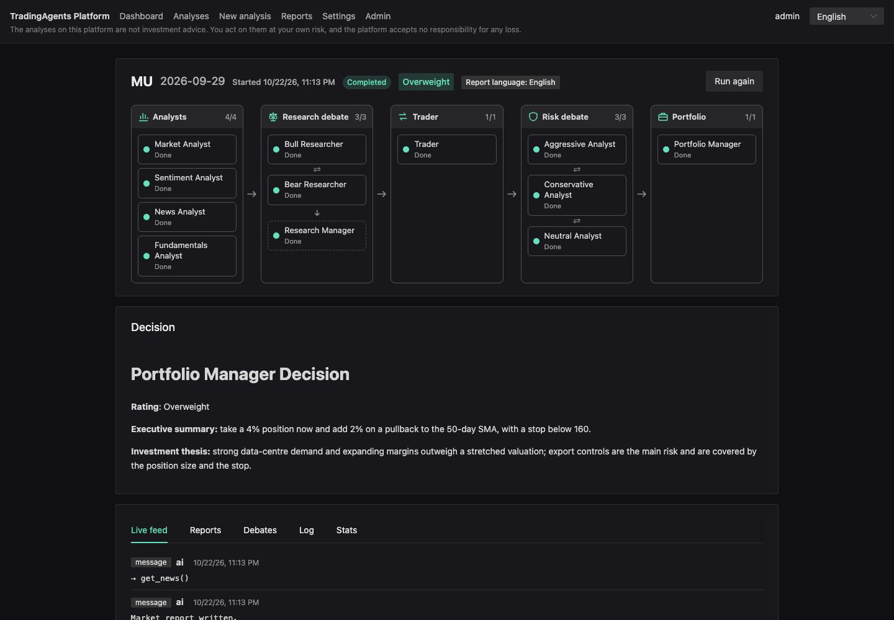

| Artifact | Path | Stack |
|---|---|---|
| Platform (backend + UI, one jar) | `artifact/backend`, `artifact/frontend` | Java 25, Spring Boot 4.1 · Vue 3.5, Vite, Naive UI |
| Runner (installed into the TradingAgents runtime) | `artifact/ta-runner` | Python 3.12, uv, TradingAgents `v0.5.1` |
| Docker images and Compose setup | `deploy/`, `artifact/ta-runner/Dockerfile` | Temurin 25 JRE · PostgreSQL 18 · docker-socket-proxy |
| Server deployment | `deploy/server/` | Ansible over SSH |
| End-to-end tests (not shipped) | `e2e/` | Playwright, against the built jar |

Two ways to run it: on your machine with `mise run run` ([Quick start](#quick-start)), or with
Docker Compose, where each analysis runs in its own container and the data is kept in PostgreSQL
([Run with Docker Compose](#run-with-docker-compose)).

## Quick start

### 1. Prerequisites

- [mise](https://mise.jdx.dev/) — it installs the rest: Java 25 (Temurin) and
  [uv](https://docs.astral.sh/uv/), pinned in [`mise.toml`](mise.toml), into its own directory.
  Install it with `curl https://mise.run | sh` (or `brew install mise`).
- An API key for at least one LLM provider (OpenAI, Anthropic, Google, DeepSeek, xAI, Mistral,
  Groq, …), or a local [Ollama](https://ollama.com/), which needs no key.
- Docker or Podman (`mise run setup` installs one when there is none: Docker on Ubuntu or Debian,
  Podman on macOS with Homebrew; `PLATFORM_INSTALL_ENGINE=0` skips that). Under `mise run`, a
  running Podman machine's socket is set as `DOCKER_HOST` unless it is set already
  (`scripts/container-env.sh`); a Gradle daemon started before that needs `./gradlew --stop`. `mise run run` and
  `mise run dev` start a local PostgreSQL 18 container
  (`mise run db`; its data is in the volume `trading-analysis-platform-db`; `mise run db:stop` stops
  it, `mise run db:reset` deletes its data). To use your own PostgreSQL 18 server instead, set
  `PLATFORM_DB_HOST`, `PLATFORM_DB_PORT`, `PLATFORM_DB_NAME`, `PLATFORM_DB_USER` and
  `PLATFORM_DB_PASSWORD`; then no container is started if `PLATFORM_DB_HOST` is another host. For a
  server on `localhost` also set `PLATFORM_DB_CONTAINER=false`, else the container is started and
  needs the port free (Docker is still needed for the backend tests).
- Nothing else: Node.js and pnpm are downloaded by the build, Python 3.12 by uv.

### 2. Start the platform

```sh
git clone https://github.com/ramazangirgin/trading-analysis-platform.git
cd trading-analysis-platform
mise trust && mise install   # once: Java 25 and uv for this repository
mise run setup               # once: ta-runner (downloads TradingAgents), the UI packages, a container engine if missing
mise run run                 # builds the app if needed and serves it on :8080
```

Open **http://127.0.0.1:8080**. One process serves both the UI and the API; keep the terminal open
while you use it, and stop it with Ctrl+C. The first start takes a few minutes (Gradle's
dependencies, Node, building the UI and the backend); after that it starts in seconds, and after a
`git pull` it rebuilds only what changed. Analyses, presets and keys live on disk
([Where things live](#where-things-live)), so they survive restarts.

If the platform stops while an analysis runs (a crash, a `kill`), the analysis keeps going; the
restarted platform follows it again, or records its result if it finished meanwhile, and starts
queued analyses again. Ctrl+C in the terminal stops the running analyses too.

Changing the code instead? See [Development](#development) — it runs the UI with hot reload.

### 3. Log in

The first start creates the user `admin` and prints a generated password once in the terminal:

```
First start: created the admin user "admin" with the generated password <password>. It is shown only this once; change it after the first login.
```

Log in at **http://127.0.0.1:8080** with it. The first admin has the ADMIN role, with every
permission. To choose the name and password instead, set
`PLATFORM_ADMIN_USERNAME` and `PLATFORM_ADMIN_PASSWORD` before the first start; the password must
meet the password policy (at least 12 characters, not a common password, not the username), or the
platform does not start and says why. Later starts change nothing. A generated password is flagged
to be changed: after logging in with it, the UI asks for a new password before anything else. If
you lost it while `admin` is still the only user, delete the user
(`DELETE FROM "IDENTITY"."USERS";` in the database) and restart to get a new one.

Every page shows a short investment disclaimer under the header; the About page (`/about`, linked
from the footer and the login page) shows the full text and opens without a login.

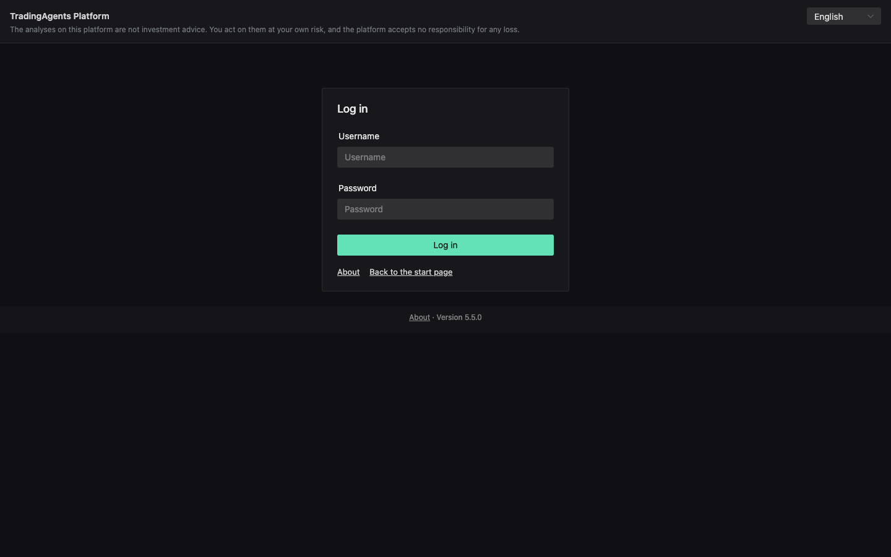

Without a login, the main page is a **landing page**: what the platform does, a **Log in** button
and cards of the latest analyses that their owners made **Partial** (see
[step 6](#6-watch-it-and-read-the-results)), each with the start of its text faded and locked. A card opens
the **preview page**: the parts the owner allows in full, the other sections as blurred
placeholders with their titles, and a **Log in** button. No text of a locked section ever reaches
the visitor's browser. After logging in, the visitor lands on the full analysis they were looking
at. A logged-in user who opens `/` sees the dashboard, and `/preview/<id>` leads to the analysis
itself. There is no self-registration yet: only an admin creates users.

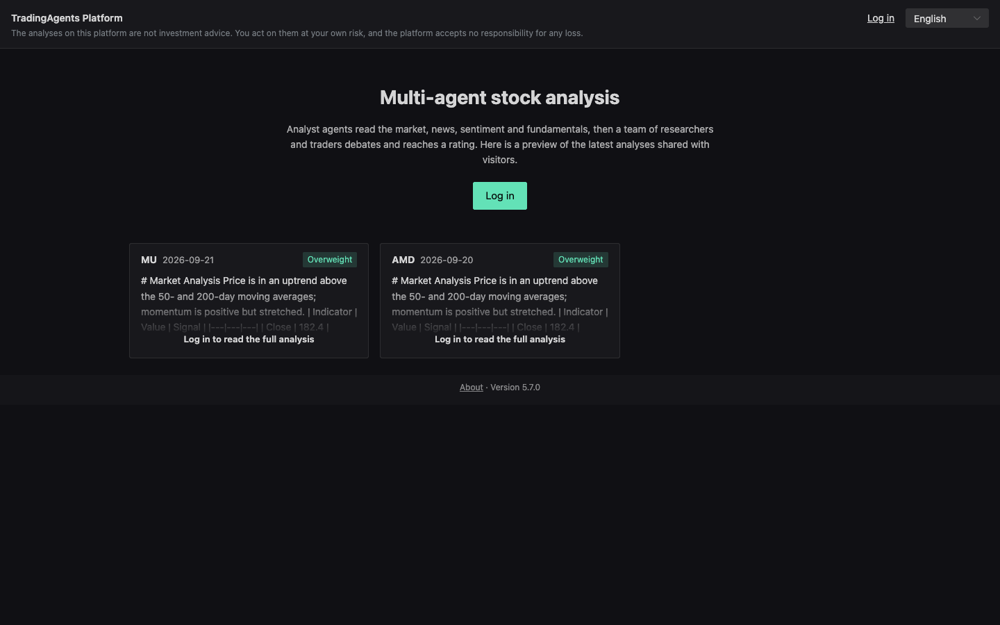

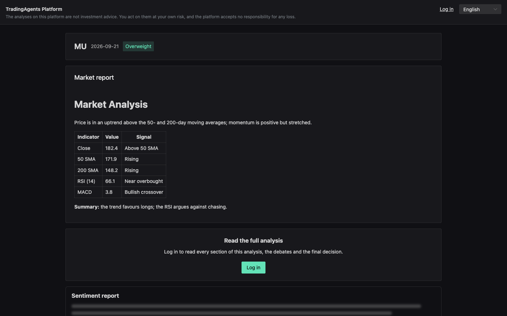

More users are added in the UI, under **Admin → Users**: **New user** takes a username, roles and
a one-time password, generated or entered. A generated one is shown once, to pass on; the user
must change it at the first login. Per row an admin edits the roles, disables or enables the
account (there is no delete), resets the password and unlocks a locked account. The UI explains
beforehand what the platform refuses: disabling yourself, removing your own ADMIN role, or
disabling or demoting the last enabled ADMIN. The page needs the permission `user:read`, its
changes `user:manage`.

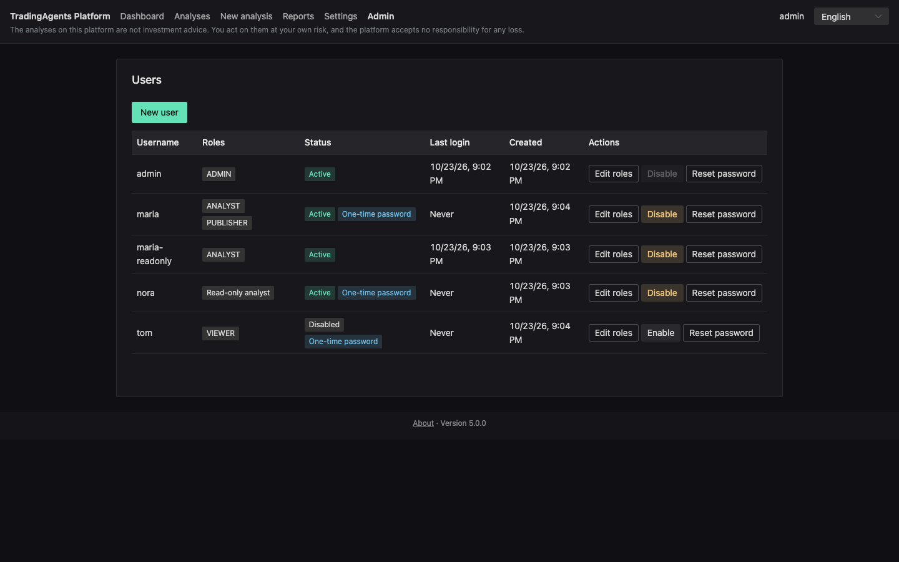

**Admin → Roles** (permission `role:manage`) lists every role with its permissions and its number
of users. **New role** takes a name, a description and the permissions, chosen from a checklist
grouped by area (analysis, presets, settings, users and roles, audit). **Edit** changes a custom
role's name, description and permissions; **Delete** removes it. On the built-in roles the name and
description cannot be changed, ADMIN keeps all its permissions, and none of them can be deleted; a
role that users still hold cannot be deleted either. The page explains this beforehand. A change to
a role applies to the users who are logged in on their next request, without logging in again.

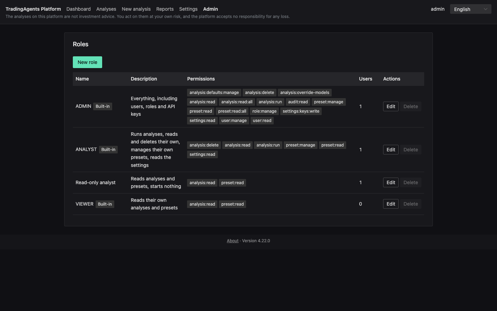

### 4. Add an API key

Open **Settings**, paste the key next to its provider and press **Save**. Keys are stored in
`~/.tradingagents-platform/secrets.env` (owner-only) and are never shown back. A key already in
`artifact/ta-runner/.env` is picked up too (read-only).

The **Analysis defaults** card below the keys holds the provider, the deep- and quick-thinking
model and the two round counts that every analysis uses. Only users with
`analysis:defaults:manage` (ADMIN) see it. Until an admin saves once, the catalog's defaults apply
with one round each. If another admin saved meanwhile, the save fails with a message and the card
reloads their values.

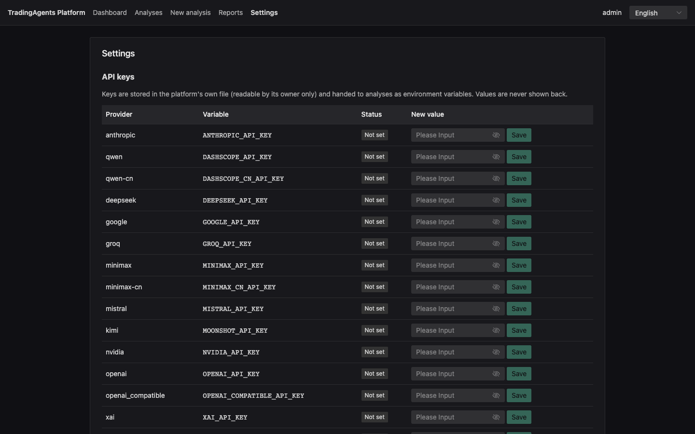

### 5. Start an analysis

Open **New analysis** and fill in:

| Field | What to enter |
|---|---|
| Ticker | Any Yahoo Finance symbol: `NVDA`, `THYAO.IS`, `BTC-USD` (crypto pairs switch the asset type automatically) |
| Analysis date | Defaults to the last weekday; future dates are rejected |
| Analysts | Market, Sentiment, News, Fundamentals — fewer analysts means a faster, cheaper run |
| Provider, models | A deep-thinking model (research/portfolio managers) and a quick-thinking one (everyone else). They start from the platform's analysis defaults: read-only ("Set by the administrator") without `analysis:override-models`, editable with it, where **Reset to defaults** restores them. A model id that is not listed can be typed only for providers that allow custom ids |
| Debate rounds | The debate and risk rounds (1 to 10) come from the same defaults; every extra round adds LLM calls |
| Report language | The language of the reports and the decision; follows the UI language by default |

Press **Start analysis**. **Save as preset** keeps the provider, model and analyst choices for next
time; **Settings** lists your own presets with what each holds, and renames or deletes them. With
`preset:read:all` (ADMIN) an **All users** switch lists everyone's presets, with an **Owner** column.
Without `analysis:override-models`, applying a preset leaves the provider, models and rounds at the
platform values and saving one stores the other fields only.
Renaming a preset that someone else changed meanwhile fails with a message and the list reloads.
**Run again** keeps the values of the original analysis.

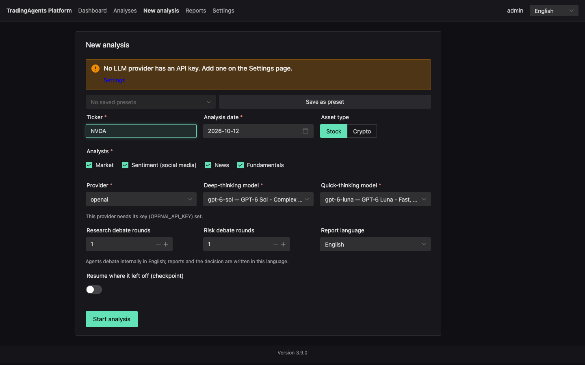

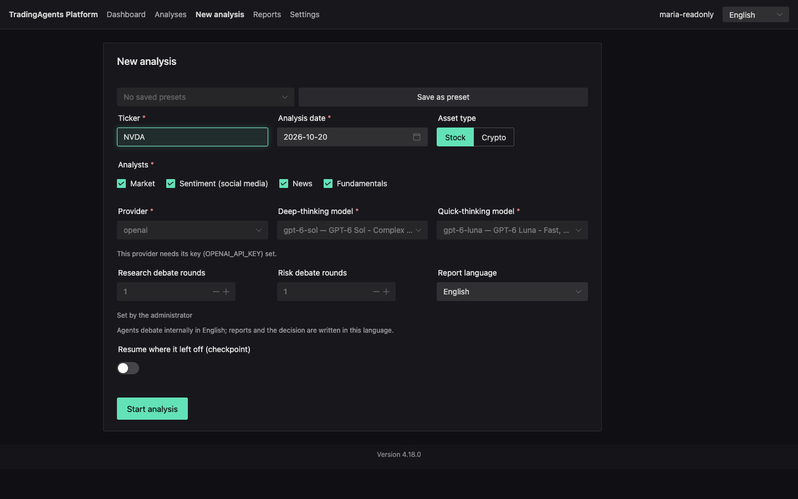

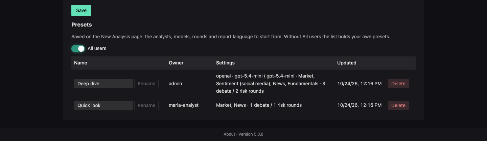

### 6. Watch it and read the results

The analysis page updates live: the agent pipeline (analysts → research debate → trader → risk
debate → portfolio manager), a feed of agent messages and tool calls, the runner log, and token
counts. A full run with all four analysts can take 20 minutes or more, depending on the model and
the debate rounds (the example above: 41 LLM calls, ~1.1M input tokens, 18 minutes). **Stop** ends it; **Run again**
repeats it with the same settings.

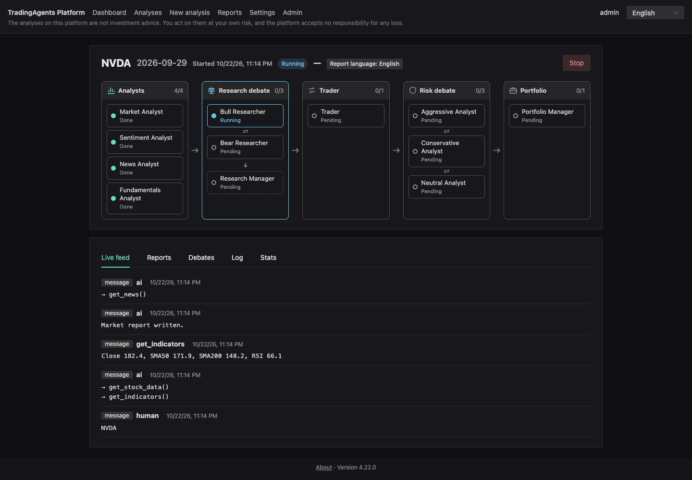

When it finishes, the decision card shows the portfolio manager's rating (Buy / Overweight / Hold /
Underweight / Sell) with its reasoning, and the tabs hold everything behind it:

| Reports — one per analyst and manager | Debates — bull vs. bear, then the risk debate |
|---|---|
| 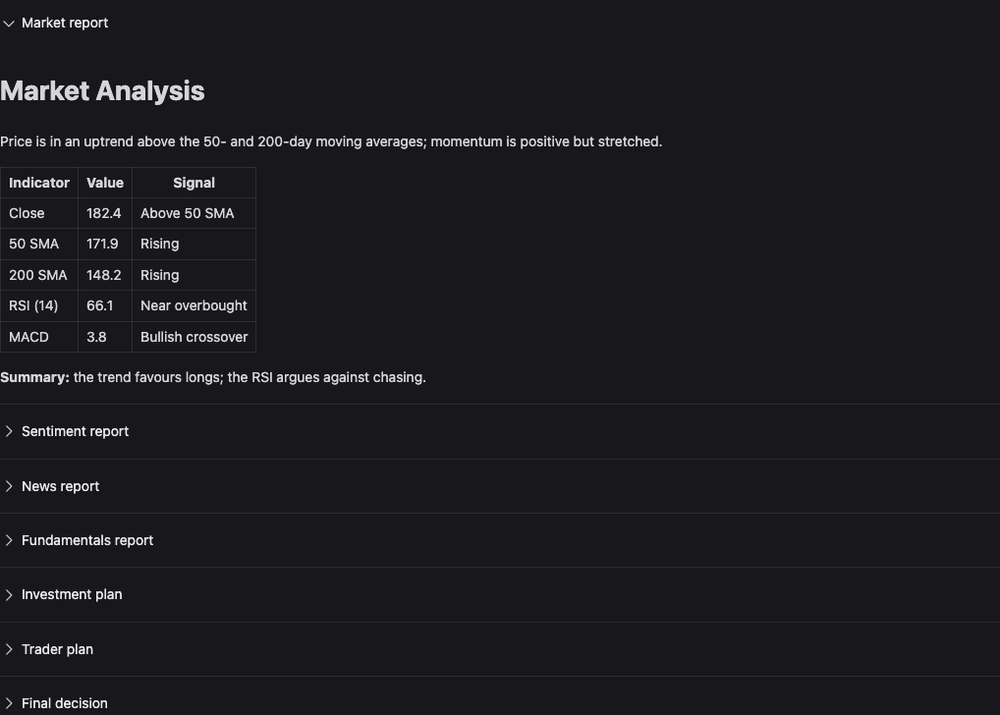 | 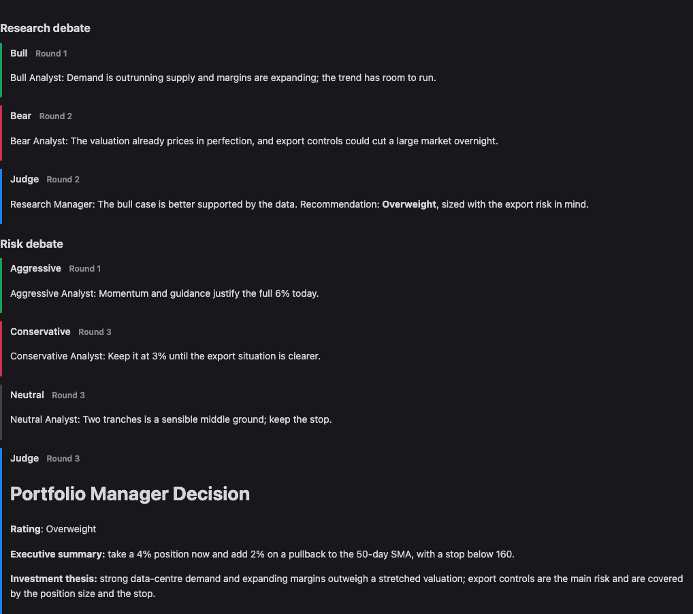 |

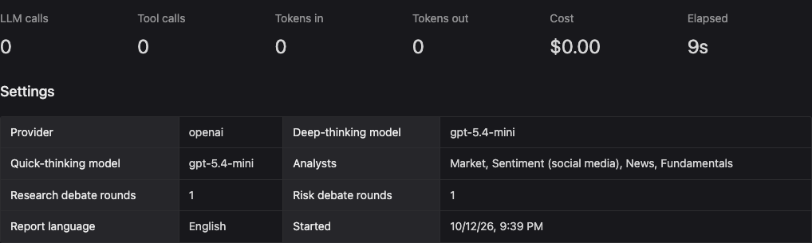

The cost is worked out per LLM call from the provider's published prices
([LLM prices](#llm-prices)); a model without a known price shows no cost.

The market report opens with a price chart — close, 10 EMA, 50 SMA and 200 SMA with volume, over
3 months to a year up to the analysis date, from the price data TradingAgents itself downloaded —
and report tables that are series over periods (quarterly or yearly figures) get a chart beside them:

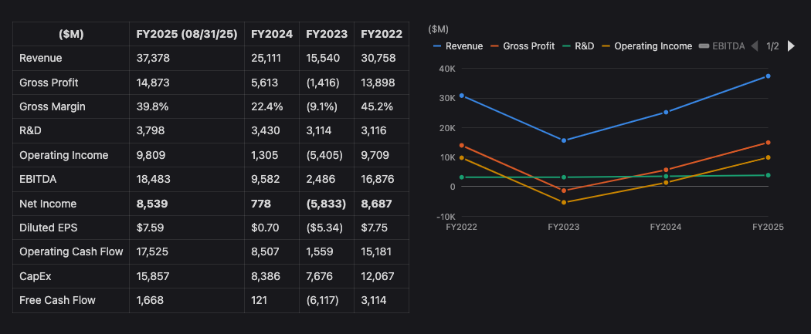

A user with the permission `analysis:share` (ADMIN, or anyone with the PUBLISHER role) can make
their own completed analysis public with the visibility select on its page (**Private**, **Public
(logged-in users)** or **Partial (preview for visitors)**), after a confirmation. With **Public**,
everyone who may read analyses sees it under **Shared with everyone**, read-only: they can open,
read, compare and export it, but not stop it, run it again or read its log. With **Partial**, the
logged-in users see it the same way, and visitors without a login see a preview of it on the
landing page (see [step 3](#3-log-in)); the confirmation says that anyone on the internet will see
it. The owner makes it private again at any time, also after losing the permission, and an admin
can make any public or partial analysis private with the same select.

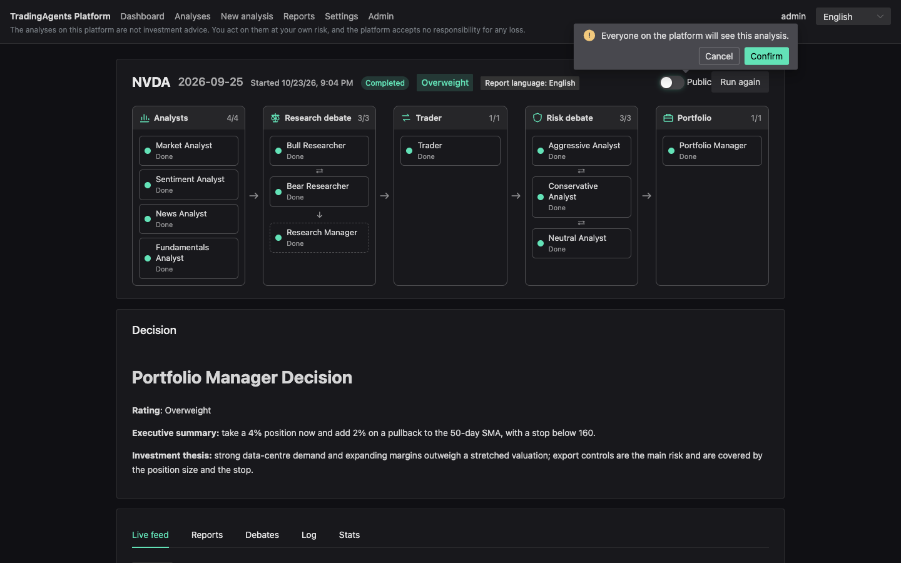

### 7. Past analyses

**Analyses** lists your own runs with their analysis date and start time, decision, model and
duration, filterable by ticker and status, under the tab **My analyses**. **Shared with everyone**
lists the analyses other users have made public (see [step 6](#6-watch-it-and-read-the-results)),
and a user with `analysis:read:all` (ADMIN) also gets an **All users** tab with everyone's runs.
Both show an **Owner** column, and a public analysis carries a **Public** tag and a partial one a **Partial** tag.
Runs made outside the platform are imported (read-only) and show up by themselves within about
10 seconds, as the data dir is watched; they belong to the first admin. **Scan data dir** forces a
rescan:

- reports the TradingAgents CLI (or another UI) left in `~/.tradingagents/logs`;
- a third-party UI's run history, `~/.tradingagents/runs.json`: its failed runs with their errors,
  and the models, token counts, cost and timing of the finished ones;
- deep-analysis write-ups, `~/.tradingagents/reports/<TICKER>_deep_<DATE>.md`, as a
  *Deep analysis* section of that ticker and date's report.

A run whose report files are still being written is not shown as failed; it appears once it
finishes.

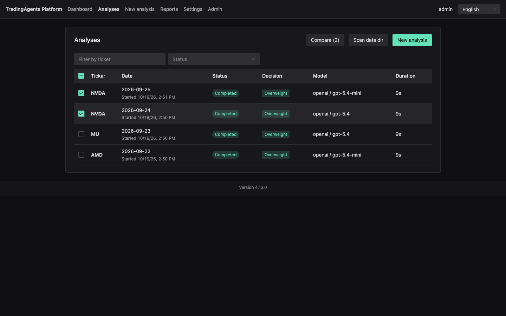

To compare runs, tick two to four of them and press **Compare**: the compare view shows them side
by side, one column per run, with the settings (ticker, date, provider and models, analysts,
debate rounds), the decision, the stats and the report sections. Rows whose values differ between
the runs are highlighted, so the same ticker run with another model or date can be compared at a
glance. The run ids are in the page's URL, so a comparison can be bookmarked or shared.

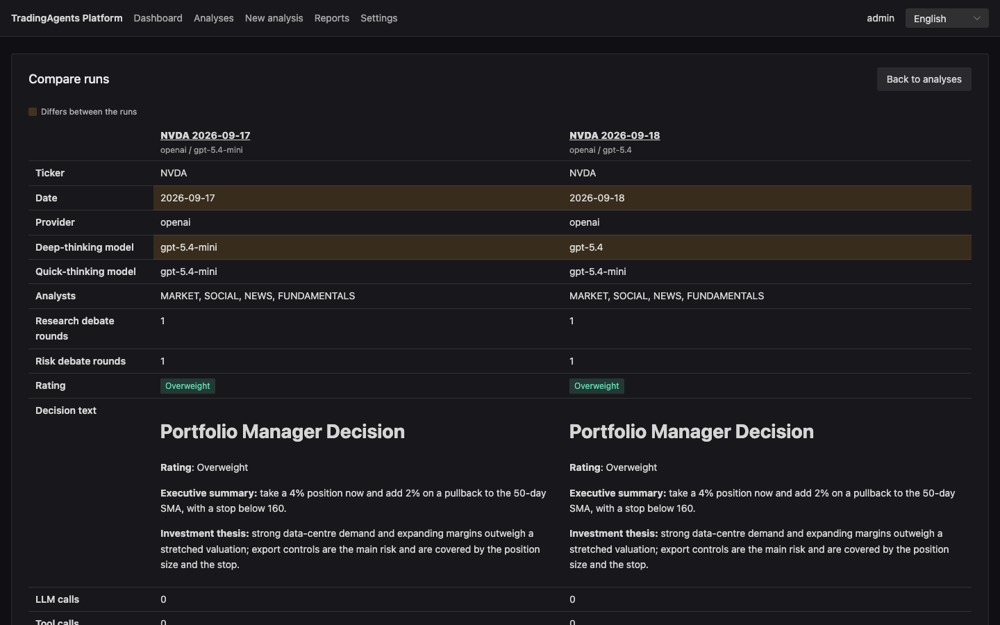

The **Dashboard** shows the running analyses and the latest decisions at a glance.

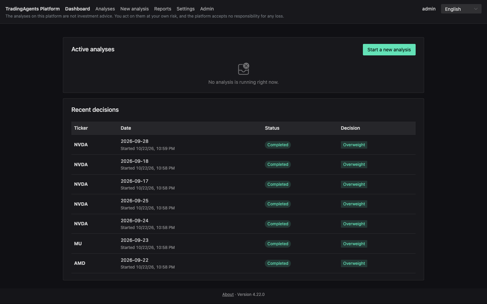

### 8. Reports and export

**Reports** gathers every finished report in one place: the list of tickers and dates on the left,
the report's contents in the middle (each section with its headings, then the debates), and the
report itself with its charts on the right. The data dir keeps one report per ticker and date, so
when a ticker and date ran several times, this is the newest run's report.

**Markdown**, **HTML** and **PDF** export the open report: the HTML file is a single page that
opens anywhere, and PDF goes through the browser's print dialog (*Save as PDF*). On a phone the page
folds into one column, with the list as a picker and the contents folded above the report.

Every report, on screen and in every export, ends with the investment disclaimer, in the report's
language rather than the screen language.

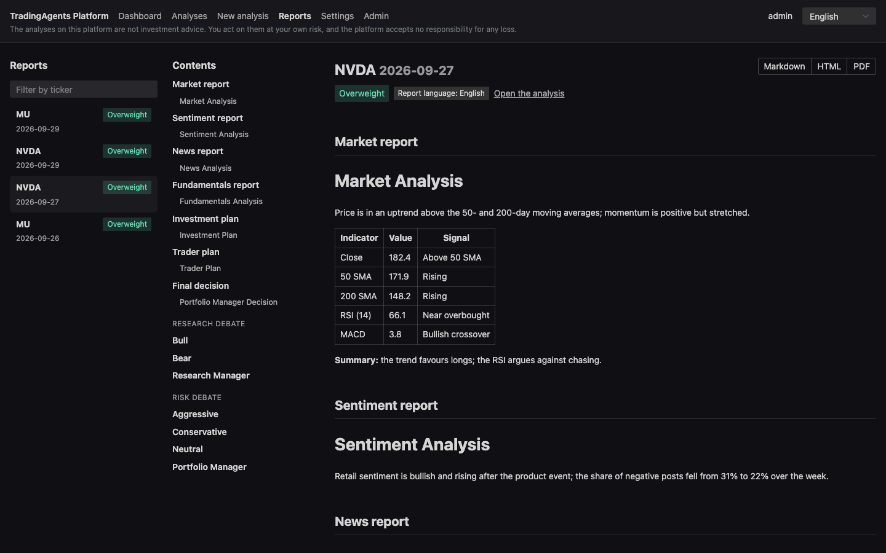

### Language

The UI is in English. Reports are written in the language chosen in the New Analysis form's
"Report language" field; the analysis page shows it as a tag.

## Run with Docker Compose

For a server (or any machine with Docker or Podman): the platform, PostgreSQL and a socket proxy
run as containers, and every analysis runs in a container of its own that is removed afterwards.

```
browser ──▶ 127.0.0.1:8080 ──▶ platform ──▶ postgres
                                  │
                                  └──▶ docker-socket-proxy ──▶ Docker / Podman engine
                                                                  │  one per analysis
                                                                  ▼
                                                          ta-runner container
```

**Needs:** Docker with Compose v2, or Podman with `docker compose` pointed at its socket; and
[mise](https://mise.jdx.dev/) to build the images. To run it on a server instead of your own machine,
[`deploy/server/`](deploy/server/README.md) sets up any Ubuntu server you can reach over SSH and
deploys this setup on it.

```sh
cp deploy/.env.example deploy/.env      # set PLATFORM_DATA and POSTGRES_PASSWORD
mise run docker-build                   # builds trading-analysis-platform and ta-runner, tagged latest and with the version
docker compose -f deploy/docker-compose.yml up -d
```

Open **http://127.0.0.1:8080** (or the `PLATFORM_PORT` you set), log in and add an API key under
**Settings**, as in the [Quick start](#4-add-an-api-key). `.env` may set `PLATFORM_ADMIN_USERNAME` and
`PLATFORM_ADMIN_PASSWORD` for the first admin; without them the generated password is in
`docker compose -f deploy/docker-compose.yml logs platform`. It may also set
`PLATFORM_PASSWORD_MIN_LENGTH` (8 to 64, default 12). `docker compose -f
deploy/docker-compose.yml down` stops everything; `up -d` brings it back with all data.

**Data** stays on the machine, in the folder named by `PLATFORM_DATA` (an absolute path):

| Folder | What |
|---|---|
| `postgres/` | The database: analyses, presets and users. Survives restarts, `down` and image updates. |
| `platform/` | `secrets.env` (API keys, owner-only), `runs/<id>/` (events and runner logs), optional `prices.json` |
| `tradingagents/` | TradingAgents' reports, price cache and memory log, written by the analysis containers |

Back up the whole folder; for the database alone, `docker compose -f deploy/docker-compose.yml exec
postgres pg_dump -U platform platform > platform.sql`. Table and column names are uppercase and
stored quoted, so a hand query quotes them too: `SELECT * FROM "ANALYSIS"."ANALYSES";`.

**How analyses run:** the platform asks the engine, through docker-socket-proxy, for one
`ta-runner` container per analysis: read-only root filesystem, no Linux capabilities, a non-root
user, 2 GB of memory and 2 CPUs, and only the `tradingagents/` folder mounted. The proxy lets the
platform create, start, stop and remove containers and nothing else (no `exec`, images, volumes or
networks). If the platform restarts during an analysis, the container keeps running and the
platform picks it up again.

**Notes**

- **SELinux** (Fedora, RHEL, Podman machines): the Compose file labels its folders with `:z`, and
  the proxy runs without SELinux labelling so it can reach the socket.
- **Podman on macOS:** `PLATFORM_DATA` must be a folder the Podman machine can see. A machine
  created without `--volume` shares no macOS folders; use a path inside the machine (e.g.
  `/var/home/core/trading-analysis-platform`) or recreate it with `podman machine init --volume
  $HOME:$HOME`. `DOCKER_SOCKET` is the socket path inside the machine (`/var/run/docker.sock` on a
  rootful one).
- **Exposing it beyond localhost** needs HTTPS first. Login is always on (see [Login](#login)). The
  port is published on 127.0.0.1 only, and a plain Compose run stays that way. For a machine with a
  domain, [`deploy/docker-compose.public.yml`](deploy/docker-compose.public.yml) adds a Caddy
  container that gets a Let's Encrypt certificate and serves the platform on 80/443: set
  `PLATFORM_DOMAIN` and `ACME_EMAIL` in `deploy/.env` and run `docker compose -f docker-compose.yml
  -f docker-compose.public.yml up -d`. The [server setup](deploy/server/README.md) does this with
  `-e public_domain=…`, or you open the platform through an SSH tunnel instead.
- The first start takes about a minute (longer under Podman's VM on macOS).

### Upgrading to 5.0.0

`GET /api/analyses?allUsers=true` is gone: a client sends `scope=ALL` instead (without `scope` it
gets its own analyses, as `allUsers=true` would now). Existing analyses stay private. The migrations
give ADMIN the new permission `analysis:share` and add the built-in role PUBLISHER.

### Upgrading to 4.0.0

Login is always on and `PLATFORM_AUTH_ENABLED` is gone. An installation without users gets the first
admin on its next start (see [Quick start](#3-log-in)). Scripts that call the API need a session and
the CSRF header: `GET /api/auth/me` sets the `XSRF-TOKEN` cookie, `POST /api/auth/login` takes it
back in `X-XSRF-TOKEN`, and every later unsafe request sends the header too.

### Upgrading to 3.0.0

Each domain's tables now live in a database schema of its own (`"ANALYSIS"`, `"SETTINGS"`,
`"IDENTITY"`), each with its own migrations and history table, so **an existing database is reset,
not migrated**. Started on an old database, the platform would create the three schemas next to the
old tables in `public` and ignore them. Runs the platform started, presets and users are lost;
analyses that TradingAgents' CLI left in the data folder are imported again on startup. For Docker
Compose, reset as for 1.0.0:

```sh
docker compose -f deploy/docker-compose.yml down
# optional, to keep a copy: start only postgres, run the pg_dump above, then down again
rm -rf "$PLATFORM_DATA/postgres"        # the folder PLATFORM_DATA names in deploy/.env
docker compose -f deploy/docker-compose.yml up -d
```

For runs on your machine (`mise run run`), `mise run db:reset` empties the local database; the next
start is a fresh one. On your own PostgreSQL server, drop and recreate the database.

### Upgrading to 2.0.0

The database is migrated in place on the first start: enum columns become PostgreSQL enum types, an
analysis's analysts an array, and a role's permissions an array on the role (the `ROLE_PERMISSIONS`
table goes away). No data is lost, and nothing needs to be done. An older release cannot run on the
migrated database, so take a copy first if you may want to go back (the `pg_dump` above, with the
platform stopped).

### Upgrading to 1.0.0

PostgreSQL is now the platform's only database, and its schema was recreated, so **an existing
database is reset, not migrated**: the platform does not start on the old one (Flyway rejects its
history). Analyses that TradingAgents' CLI left in the data folder are imported again on startup;
runs the platform started, presets and users are lost. To reset:

```sh
docker compose -f deploy/docker-compose.yml down
# optional, to keep a copy: start only postgres, run the pg_dump above, then down again
rm -rf "$PLATFORM_DATA/postgres"        # the folder PLATFORM_DATA names in deploy/.env
docker compose -f deploy/docker-compose.yml up -d
```

For runs on your machine (`mise run run`) nothing is needed on a first start; a
`~/.tradingagents-platform/platform.db` file from an earlier version is no longer used and can be
deleted. `mise run db:reset` empties the local database later, whenever you want a fresh one.

## Where things live


| Path | What |
|---|---|
| PostgreSQL | Analyses, presets and users: in the local container's volume `trading-analysis-platform-db`, or on your own server ([Prerequisites](#1-prerequisites)) |
| `~/.tradingagents-platform/runs/<id>/` | `spec.json`, `events.jsonl` (replayed to the UI), `run.log` (runner stderr) |
| `~/.tradingagents-platform/prices.json` | Optional: your own LLM prices, over the ones ta-runner ships (see below) |
| `~/.tradingagents/logs/` | TradingAgents' own reports, shared with its CLI; runs found here are imported (read-only) |

Override with `PLATFORM_HOME`, `TRADINGAGENTS_HOME` or `TRADINGAGENTS_RESULTS_DIR`. With Docker
Compose everything is under `PLATFORM_DATA` instead ([Run with Docker Compose](#run-with-docker-compose)).

### LLM prices

A run's cost is worked out per LLM call from
[`artifact/ta-runner/ta_runner/pricing/prices.json`](artifact/ta-runner/ta_runner/pricing/prices.json): DeepSeek,
OpenAI, Anthropic and Google, read from their official pricing pages on 2026-09-30 (peak hours,
long-context tiers and cached input included). A model without a price shows no cost rather than
a guess. To add or correct prices, create `~/.tradingagents-platform/prices.json` in the same shape;
its models replace the shipped ones one by one:

```json
{"providers": {"ollama": {"models": {"qwen3:latest": [{"input": 0, "output": 0}]}},
               "openai": {"models": {"gpt-5.6": [{"input": 2.0, "cached_input": 0.2, "output": 12.0}]}}}}
```

Prices are USD per 1M tokens. New runs pick the file up; finished runs keep their cost.

## Development

### Dev servers

```sh
mise run dev
```

This starts two processes, and keeps them running until Ctrl+C:

| Process | Port | What it does |
|---|---|---|
| Spring Boot backend | 8080 | The API (`/api/...`), the database, starting and stopping analyses (it launches ta-runner) |
| Vite dev server | 5173 | Serves the Vue UI straight from `artifact/frontend/src`, reloads the browser on every change, and forwards `/api/...` to the backend |

Open **http://localhost:5173** (not :8080) while developing. UI changes show up immediately; backend
changes need a restart of `mise run dev`. Nothing listens on 5173 unless `mise run dev` is running —
to just use the app, `mise run run` is enough. `mise run dev` needs a login too, with the same first
admin ([Quick start](#3-log-in)).

### Login

The backend has a server-side session login ([#78](https://github.com/ramazangirgin/trading-analysis-platform/issues/78)),
always on. The first start creates the first admin ([Quick start](#3-log-in)). The UI has a login
page (`/login`):


- Opening any page without a session leads to `/login?redirect=<page>`; after login the UI returns
  to the requested page. The header shows the username with a logout action, which ends the session
  and loads `/login` afresh. When the session ends (any 401), the UI goes back to the login page.
- When a run's live stream closes because the session ended, the run page goes to the login page
  and returns to the run after login.
- The UI sends the CSRF header `X-XSRF-TOKEN` itself on every unsafe request.
- An endpoint is checked in this order: 401 without a session, then 400 from request validation,
  then 403 `forbidden` from the endpoint's permission. A caller without the permission who sends an
  invalid body therefore gets 400 with the validation errors; only a valid request reaches the
  permission check.
- The end-to-end tests log in as the first admin that `e2e/start-platform.sh` configures
  (`admin` / `e2e-test-password`), and so do the screenshots.

Changing the password: the user menu → **Change password** opens `/password`. A user whose
password is flagged to be changed (a generated or one-time password) is sent there right after
login and can do nothing else until they set a new one. A change clears the flag and logs the
user's other sessions out; the current session continues.

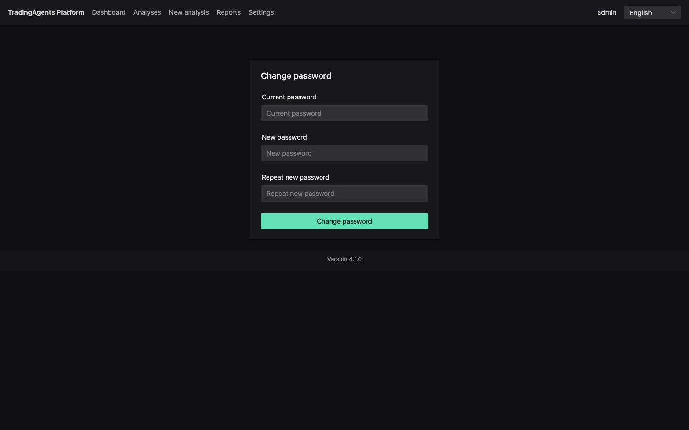

Investment disclaimer: the login page included, every page shows a muted line under the header,
and the public About page (`/about`) shows the full text (see [Log in](#3-log-in)). The wording is
`app.disclaimer` in the translation files, shown by the `DisclaimerNotice` component.

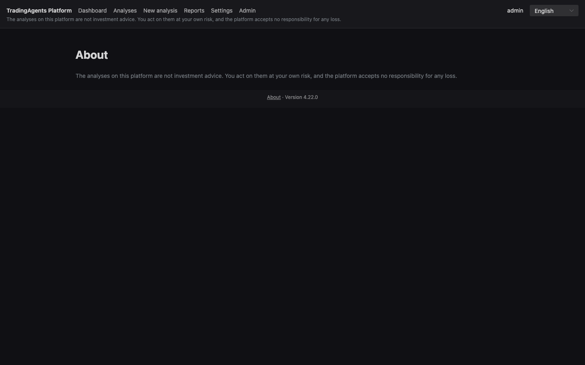

The backend:

- `POST /api/auth/login` (`username`, `password`) answers 200 with the user, their roles and
  permissions, or 401 `bad_credentials` or 429 `too_many_login_attempts`; `GET /api/auth/me` returns the current user, or 401
  `unauthorized`; `POST /api/auth/logout` ends the session (204).
- `POST /api/auth/password` (`currentPassword`, `newPassword`) answers 200 with the user (flag
  cleared), or 400 `wrong_current_password` / `password_unchanged` / `weak_password`. The last one
  carries `params.reasons` (`too_short`, `too_long`, `common`, `same_as_username`), `minLength` and
  `maxLength`. A session whose password must be changed gets 403 `password_change_required` on
  every `/api/**` route but `me`, `password` and `logout`.
- The password policy follows NIST SP 800-63B: 12 to 128 characters (counted as Unicode code
  points), no composition rules, not one of the 10,000 most common passwords (bundled from
  [SecLists](https://github.com/danielmiessler/SecLists), so nothing leaves the machine) and not
  the username. The minimum is set with `PLATFORM_PASSWORD_MIN_LENGTH` (8 to 64, default 12).
- Password guessing is slowed down ([#85](https://github.com/ramazangirgin/trading-analysis-platform/issues/85)).
  After 5 wrong passwords in a row an account is locked for 15 minutes. While it is locked, every
  login answers the same 401 `bad_credentials` as a wrong password, even with the right one, so a
  locked account cannot be told from a wrong guess or an unknown user. A locked account is not
  counted further, and a successful login resets the count. Each client address may also fail 20
  logins in 5 minutes; after that it gets 429 `too_many_login_attempts` with `Retry-After` until
  the window frees up. The address is the one of the connection (`X-Forwarded-For` is not trusted),
  so under Docker Compose all clients may share the bridge gateway's address and the limit applies
  to them together. The counts of the IP limit live in memory like the sessions, so a restart
  clears them. The settings, all checked at startup:

  | Variable | Default | Range |
  |---|---|---|
  | `PLATFORM_LOGIN_MAX_FAILED_ATTEMPTS` | `5` | 1 to 100 |
  | `PLATFORM_LOGIN_LOCKOUT_DURATION` | `15m` | 1 minute to 24 hours |
  | `PLATFORM_LOGIN_IP_MAX_FAILED_ATTEMPTS` | `20` | 1 to 10,000 |
  | `PLATFORM_LOGIN_IP_WINDOW` | `5m` | 1 minute to 24 hours |

- Admins manage accounts through `/api/users`. Reading needs `user:read`, every change
  `user:manage`; without the permission the answer is 403 `forbidden`. A user has no hard delete: an
  admin disables the account instead. A `UserDto` has the `id`, `username`, `roles` (`id` and `name`,
  sorted by name), `enabled`, `mustChangePassword`, `locked` (an expired lock reads as not locked),
  `lockedUntil`, `lastLoginAt` (null until the first successful login), `createdAt`, `updatedAt` and
  `version`.
  - `GET /api/users` lists the users sorted by username, ignoring case; `GET /api/users/{id}`
    gives one (404 `user_not_found`).
  - `POST /api/users` with `{"username", "roleIds", "password"}` creates an enabled user and answers
    201 `{"user", "oneTimePassword"}`. A blank or missing `password` means "generate one": it is
    returned once, in `oneTimePassword`, and never again. An entered password is not echoed
    (`oneTimePassword` is null). Either way the user must change it at the first login
    (`mustChangePassword`, 403 `password_change_required` on other routes). Errors: 400
    `invalid_username`, `weak_password` (with `params.reasons`), `unknown_role` (`params.roleId`) or
    `invalid_request`; 409 `username_taken` (also in another case).
  - `PATCH /api/users/{id}` with `{"roleIds", "enabled", "version"}` changes the roles, the status
    or both; a field that is left out stays as it is, and one of `roleIds` and `enabled` is
    required (400 `invalid_request`). `version` is optional: without it the write applies to what is
    stored, with a stale one the answer is 409 `concurrent_update`. It answers 200 with the `UserDto`,
    400 `unknown_role`, 404, or one of the guard rails below.
  - `POST /api/users/{id}/password-reset` with `{"password"}` (blank or missing: generate one) gives
    the user a new one-time password and answers 200 `{"oneTimePassword"}` (null when the admin
    entered it); 400 `weak_password`; 404. The user must change it at the next login, and a reset
    also clears a lockout. It does not enable a disabled user.
  - `POST /api/users/{id}/unlock` unlocks an account early. It answers 204 (also when the account
    is not locked) or 404 `user_not_found`.
  - **Guard rails** (409): an admin cannot disable themselves (`cannot_disable_self`) or remove
    their own ADMIN role (`cannot_remove_own_admin`), and nobody can disable or demote the last
    enabled ADMIN (`last_admin`), so the platform always has an admin. The check and the write run
    under one lock, which is enough for one backend instance.
  - **Sessions end at once**: when a user is disabled, when their password is reset (also an
    admin's own: they log in again with the one-time password), and when their roles change. The
    next API request of such a session gets 401, and its open event streams close; a request for
    the UI (a page or a script) is redirected to itself and loads without the session, so the UI
    goes to the login page instead of failing to load. An admin who changes
    their own roles keeps their current session with its old permissions until the next login or
    the next change to a role (a permission change applies to the next request, see `/api/roles`).
  - The UI's **Admin → Users** page (`/admin/users`) uses these endpoints, explains a blocked guard
    rail before the request, and shows the one-time password once.
- Admins manage roles through `/api/roles` ([#90](https://github.com/ramazangirgin/trading-analysis-platform/issues/90)).
  Reading needs `user:read` or `role:manage` (the user forms read the roles), every change
  `role:manage`; without the permission the answer is 403 `forbidden`. A `RoleDto` has the `id`,
  `name`, `builtIn`, `description`, `permissions` (keys, sorted), `userCount` (the users, enabled or
  not, that hold the role) and `version`.
  - `GET /api/roles` lists the roles sorted by name; `GET /api/roles/{id}` gives one (404
    `role_not_found`).
  - `POST /api/roles` with `{"name", "description", "permissions"}` creates a custom role and
    answers 201 with the `RoleDto` and `Location: /api/roles/{id}`. `permissions` may be empty, so a
    role can be prepared before it grants anything. Errors: 400 `invalid_role_name`,
    `invalid_role_description` or `invalid_request` (also an unknown permission key); 409
    `role_name_taken`.
  - `PATCH /api/roles/{id}` with `{"name", "description", "permissions", "version"}` changes the
    given parts; a part that is left out stays as it is, and one of `name`, `description` and
    `permissions` is required (400 `invalid_request`). `version` is optional: with a stale one the
    answer is 409 `concurrent_update`. It answers 200 with the `RoleDto`, the 400 and 404 errors of
    the above, or 409 `built_in_role` or `role_name_taken`.
  - `DELETE /api/roles/{id}` answers 204, 404, or 409 `built_in_role` or `role_in_use`
    (`params.userCount`).
  - The UI's **Admin → Roles** page (`/admin/roles`) uses these endpoints.
  - **Names** are trimmed and have 2 to 40 characters: ASCII letters, digits, space, `_` and `-`.
    They are unique ignoring case, so a custom `admin` cannot sit next to `ADMIN`. A description has
    at most 200 characters.
  - **Built-in roles**: ADMIN, ANALYST, VIEWER and PUBLISHER keep their name and description and
    cannot be deleted (409 `built_in_role`, `params.change`). The permissions of ANALYST, VIEWER
    and PUBLISHER can change; ADMIN's cannot, so the platform always has a role with every permission. Sending
    the current name or description of a built-in role is not a change.
  - **An assigned role cannot be deleted**: while any user, also a disabled one, holds it, the
    answer is 409 `role_in_use`. An admin removes the role from the users first.
  - **A permission change applies to the next request** of every logged-in holder of the role,
    without a new login. An open event stream is not a request: it keeps running until it ends or
    its session ends, even when the role lost `analysis:read`.
- The platform's analysis defaults are read and saved through `/api/settings/analysis-defaults`
  ([#198](https://github.com/ramazangirgin/trading-analysis-platform/issues/198)). An
  `AnalysisDefaultsDto` has `llmProvider`, `deepThinkLlm`, `quickThinkLlm`, `maxDebateRounds`,
  `maxRiskDiscussRounds` and `version`.
  - `GET` answers the saved values. While nothing is saved it answers the catalog's defaults (upstream's,
    with its `TRADINGAGENTS_*` overrides) with one round each and `version` `null`, so a fresh install
    works without an admin step; a `GET` asks the catalog only for this fallback, so only then can it
    answer 503 `catalog_unavailable`.
  - `PUT` with the five values and `version` saves them and answers 200 with the `AnalysisDefaultsDto`
    and its new version. `version` is the one the client read, `null` only for the first save. The
    provider must be in the catalog, both models must be listed for it, and both round counts must be
    1 to 10, or the answer is 400 `invalid_analysis_defaults` with `params.field` naming the value.
    The values are checked against the catalog, so the save answers 503 `catalog_unavailable` while
    the catalog cannot be read. A
    stale `version`, also a `null` one while values are saved, answers 409 `concurrent_update`: of two
    admins who save at the same time, also the first time, the second one gets it.
- `POST /api/analyses` decides the provider, both models and both round counts itself: the five
  fields are optional and default to the platform's analysis defaults. Sending a value that differs
  from them needs `analysis:override-models`; without it the answer is 403
  `analysis_override_forbidden` with `params.field` naming the first differing field. An override
  must be in the catalog (provider, and each model for it unless the provider allows custom ids), or
  the answer is 400 `invalid_spec`. A rerun keeps the original analysis's values.
- Every other `/api/**` route needs a permission: 401 (`unauthorized`) without a session, 403
  (`forbidden`) without the permission. The permission is the `@RequiresPermission` on the endpoint's
  delegate method. The build fails (Checkstyle rule `TAP-A1`) while a delegate method has neither
  `@RequiresPermission` nor `@NoPermissionRequired("reason")`, the marker of the auth routes, and
  `EndpointPermissionsIntegrationTest` checks it at runtime. The static UI,
  `/actuator/**` and `/api/openapi/**` stay open. The permissions per endpoint group:

  | Endpoints | Permission |
  |---|---|
  | `POST /api/auth/password` | a session only (everyone changes their own password) |
  | `POST /api/analyses`, `…/{id}/stop`, `…/{id}/rerun`, `POST /api/reports/rescan` | `analysis:run` |
  | `GET /api/analyses`, `…/{id}`, `…/report`, `…/prices`, `…/logs`, `…/events` | `analysis:read`; another user's analysis answers 404 without `analysis:read:all`, unless it is public (not its `…/logs`) |
  | `PUT /api/analyses/{id}/visibility` | `analysis:read`; making it public needs `analysis:share` too, checked by the use case |
  | `GET /api/catalog`, `GET /api/health` | `analysis:run` or `settings:read` |
  | `GET /api/secrets` | `settings:read` |
  | `PUT` and `DELETE /api/secrets/{name}` | `settings:keys:write` |
  | `GET /api/settings/analysis-defaults` | `analysis:run` or `analysis:defaults:manage` |
  | `PUT /api/settings/analysis-defaults` | `analysis:defaults:manage` |
  | `GET /api/presets` | `preset:read` |
  | `POST`, `PUT` and `DELETE /api/presets…` | `preset:manage` |
  | `GET /api/users`, `GET /api/users/{id}` | `user:read` |
  | `GET /api/roles`, `GET /api/roles/{id}` | `user:read` or `role:manage` |
  | `POST`, `PATCH` and `DELETE /api/roles…` | `role:manage` |
  | `POST` and `PATCH /api/users…` (create, update, `…/password-reset`, `…/unlock`) | `user:manage` |

  Three roles are built in. ADMIN has every permission, and the first admin has it. ANALYST runs
  analyses, reads and deletes analyses, manages presets and reads the settings. VIEWER reads
  analyses and presets. `analysis:defaults:manage` (save the platform's analysis defaults) and
  `analysis:override-models` (choose provider, models and rounds per analysis) are held by ADMIN
  only; ANALYST and VIEWER do not have them, and a custom role can be given them. The fourth
  built-in role, PUBLISHER, holds only `analysis:share` (make one's own completed analyses public),
  which ADMIN holds too; an admin lets a user publish by adding PUBLISHER to their roles, which
  applies at the user's next login. Analyses are the user's own: the user who started a run owns it (a rerun
  belongs to whoever reran it, imported runs to the first admin), and another user's analysis
  answers 404 like a missing one, unless the user has `analysis:read:all` (ADMIN) or the analysis is
  public. A public analysis is readable (`GET /api/analyses/{id}`, `…/report`, `…/prices`,
  `…/events`) with `analysis:read`, but its log, stop and rerun answer 404 for everyone but its
  owner and `analysis:read:all`. Presets are the user's own too: the user who saved one owns it,
  and another user's preset answers 404 like a missing one, unless the user has `preset:read:all`
  (ADMIN). `GET /api/presets?allUsers=true` lists everyone's presets with that permission and the
  own ones without it. A VIEWER cannot save presets, so has none. On the first start after the
  upgrade, analyses and presets without an owner are given to the first
  admin. `GET /api/analyses?scope=MINE|SHARED|ALL` (default `MINE`) lists the caller's own
  analyses, the public analyses of other users, or, with `analysis:read:all`, everyone's; `ALL`
  without that permission lists the own ones. Admins can add custom roles with any set of
  permissions. The permissions of ANALYST, VIEWER and PUBLISHER can be changed, ADMIN's cannot, and
  no built-in role can be renamed or deleted.
- `PUT /api/analyses/{id}/visibility` with `{"visibility": "PUBLIC" | "PRIVATE", "version"}` makes
  an analysis public or private (the `AnalysisDto` has `visibility`, `visibilityChangedAt`,
  `version`, and `canManage` and `canChangeVisibility` for the caller). Only the owner makes an
  analysis public, and only a `COMPLETED` one, with `analysis:share`. The owner makes it private
  again at any time, also without the permission; an admin with `analysis:share` makes any public
  analysis private. Answers: 200 with the `AnalysisDto`; 403 `analysis_share_forbidden` (the owner
  lacks `analysis:share`); 404 (not visible to the caller, or someone else's analysis made public);
  409 `analysis_not_shareable` (`params.status`, the analysis is not completed); 409
  `concurrent_update` (a stale `version`). Asking for the visibility the analysis has changes
  nothing. The UI hides the links, buttons and pages the user has no permission for; the backend
  rules are what protect.
- The live event stream of a run (`GET /api/analyses/{id}/events`) needs a session and
  `analysis:read` like the other analysis reads (another user's run answers 404 unless the user has
  `analysis:read:all` or the analysis is public), and a stream that is open when its session ends (logout, idle timeout,
  a password change in another session, a disable or password reset by an admin) is closed by the server.
- Every unsafe request needs the CSRF token: the SPA echoes the `XSRF-TOKEN` cookie in the
  `X-XSRF-TOKEN` header, or gets 403 `invalid_csrf_token`. `GET /api/auth/me` sets the cookie.
- Sessions live in the server's memory, so a restart logs everyone out. The idle timeout is
  `PLATFORM_SESSION_TIMEOUT` (default `30m`).

### Tasks

```sh
mise run setup         # uv sync for ta-runner (downloads TradingAgents), frontend packages, Git hooks, a container engine if there is none
mise run container-engine  # check Docker or Podman, and install one when there is none (scripts/container-engine.sh)
mise run dev           # backend on :8080 + Vite with hot reload on http://localhost:5173 (starts the local PostgreSQL)
mise run build         # all tests (ArchUnit included), lint (Checkstyle included), dependency checks (Gradle analysis, Knip), and the single jar
mise run run           # the single jar on http://127.0.0.1:8080, rebuilt when something changed (starts the local PostgreSQL)
mise run db            # start the local PostgreSQL container (run and dev do it for you)
mise run db:stop       # stop it; the data stays in the volume
mise run db:reset      # remove the container and its volume: the next start is an empty database
mise run test          # backend + frontend + ta-runner tests
mise run runner-test   # ta-runner lint, import contracts, dependency check (deptry) and tests only
mise run e2e           # end-to-end tests: the jar on a throwaway PostgreSQL container, in Google Chrome with login on (a seeded user), ta-runner replaying a recording
mise run screenshots   # retake the README's screenshots (e2e/screenshots/*.shot.ts), the same way
mise run check         # quick check before pushing: package structure, every domain with persistence has its conventions test, lint, formatting, type-check, dependency declarations (Gradle analysis, Knip, deptry), the agent scripts' and skill helpers' Python tests (`agent:test`, `skill:test`; no other tests)
mise run format        # format every Java (Spotless), frontend and e2e (Prettier) file
mise run format-check  # check the formatting of every Java, frontend and e2e file, as CI does
mise run hooks         # install the Git hooks (lefthook.yml)
mise run api-types     # refresh the frontend's API types from the running backend
mise run docker-build  # the platform and ta-runner Docker images
mise run server:deploy # set up the server in deploy/server/inventory.ini over SSH and deploy the Compose stack on it (Ansible)
mise run server:tunnel # open the deployed UI from this machine: an SSH tunnel, then http://127.0.0.1:8080 (with a domain, https://<domain> works too)
mise run server:check  # ansible-lint and the playbook's syntax, without a server (not part of check)
mise run server:test-setup  # the server setup scripts against a throwaway Ubuntu container (needs Docker or Podman)
mise run server:test   # the whole server deployment with THIS machine as the server: throwaway machines only (CI)
mise run ci:test-changes  # the tests of scripts/ci-changes.sh, which decides the CI jobs a change needs
mise run version       # the platform version
mise run version:bump minor   # raise it (major, minor or patch) in every file; see Versioning and releases
```

`run`, `dev`, `build`, `test`, `e2e` and `screenshots` need Docker or Podman (a PostgreSQL container;
the backend tests start theirs through Testcontainers; on a Podman machine the build points
Testcontainers' cleanup container at the machine's own socket, so no local setting is needed). `mise tasks` lists them. Tasks run with the pinned Java on `PATH` and `JAVA_HOME` set, so nothing
needs overriding; with [mise activated](https://mise.jdx.dev/getting-started.html#activate-mise) in
your shell, plain `./gradlew` and `uv` in this directory use the same versions.

### Continuous integration

[`.github/workflows/ci.yml`](.github/workflows/ci.yml) runs on every push to `main`, on every pull
request, and on demand (*Run workflow* on the Actions tab). A branch without a pull request has no
CI until one is opened.

| Job | What |
|---|---|
| Changes | [`scripts/ci-changes.sh`](scripts/ci-changes.sh) lists the files the change touches (against the merge base with the pull request's base branch) and decides which jobs run; its test is `mise run ci:test-changes`. A change that only touches `docs/`, `.plans/`, `README.md`, `CLAUDE.md`, `.claude/` or `scripts/agent/` skips the build, jar, end-to-end, image and runner-image jobs (and the ta-runner job unless it touches `scripts/agent/` or `.claude/skills/`); *Server deploy (Ansible)* runs only when `deploy/`, `mise.toml` or `.github/` changed; *Server deploy end-to-end* only for the files listed in its row. Any file not on that list counts as an application change. On demand and on `main`, everything runs: the release takes the jar of the run on `main` |
| Backend and frontend | One Gradle run, `./gradlew spotlessCheck :frontend:pnpmLint build`: the formatting of every Java and frontend file first (a formatting failure stops the build), then the build: Spotless, Checkstyle, every Gradle test (ArchUnit, the Docker runner against the runner's own Docker, every repository and Spring Boot test against PostgreSQL in a container (Testcontainers), the database naming and schema checks of every domain (uppercase names, explicit constraint and index names, everything in the domain's own schema, a conventions test in every domain with persistence), the custom Checkstyle checks with their 100% coverage gate and the project rules' fixtures), the dependency analysis (every module declares the libraries it uses and no others), frontend lint, tests and Knip (unused and unlisted packages) |
| Platform jar | `./gradlew :backend:bootJar` in a job of its own, so the platform image and the end-to-end tests start while the build job still runs its tests. A red build still fails **CI passed**, so that jar is never released |
| ta-runner | `mise run runner-test`: ruff, import-linter (package structure), deptry (declared and imported packages match) and pytest, upstream contract tests included; then `mise run agent:test`: the Python tests of the agent scripts ([`scripts/agent/`](scripts/agent)); then `mise run skill:test`: the Python tests of the Claude Code skills' helpers ([`.claude/skills/`](.claude/skills)) |
| Version | The version is the same in every file; in a pull request into `main`, it is also higher than `main`'s and than the latest release tag, and not yet tagged (Renovate's update pull requests are exempt from the bump) |
| ta-runner image | Built beside the build job, then run under the platform's lockdown flags; the image that passed is handed to the platform image job |
| ta-runner image (arm64) | The same image built on an arm64 runner (`ubuntu-24.04-arm`) and run under the same lockdown flags, so a dependency without arm64 wheels shows up before anyone deploys to an arm64 server |
| Server deploy (Ansible) | `mise run server:check` without a server: `ansible-lint` (production profile) and the playbook's syntax; then `mise run server:test-setup`: the setup scripts against a throwaway Ubuntu 24.04 container ([`deploy/server/`](deploy/server/README.md#testing)) |
| Server deploy end-to-end | Only when `deploy/`, the ta-runner Dockerfile, the CI workflow or `scripts/ci-changes.sh` changed (otherwise it is skipped): `mise run server:test`, with the runner as the server. The setup scripts, a deploy over SSH to `127.0.0.1`, a second deploy with `changed=0`, the UI through the SSH tunnel, only SSH open, a backup, a deploy of another commit that rebuilds, key-only SSH |
| End-to-end tests | The e2e formatting (Prettier), then the platform jar job's jar, on a throwaway PostgreSQL container, in Google Chrome, in parallel (3 workers; [`e2e/`](e2e/), Playwright), with login on as the first admin: login, wrong credentials, redirect back, logout and the back button; change password (menu, wrong current password, weak new password); user management (create a user, first login with the one-time password, disable); new analysis, live run page and decision; reports and Markdown export; comparing two runs; settings (keys masked, presets). `ta-runner` replays a recording (`TA_RUNNER_REPLAY`, [`artifact/ta-runner/tests/fixtures/replay-run`](artifact/ta-runner/tests/fixtures/replay-run)) instead of calling an LLM. Traces are uploaded when a test fails |
| Platform image and Compose smoke test | The platform image (GitHub's build cache) and the ta-runner image from the job above, then [`deploy/smoke-test.sh`](deploy/smoke-test.sh): the Compose stack comes up, an analysis runs in its own container, and the data survives a database restart and `down`/`up` |

A last job, **CI passed**, succeeds only if every job succeeded or was skipped; a failed or cancelled
job fails it. New jobs go into its `needs` list, so
the rules on `main` never have to change. Those rules (the repository ruleset "main"):

- Changes reach `main` only through pull requests; no direct or force pushes, and `main` cannot be
  deleted.
- A pull request merges once **CI passed** is green, its branch is up to date with `main`, and a
  code owner has approved it ([`.github/CODEOWNERS`](.github/CODEOWNERS): the admins).
- Admins can merge their own pull requests without an approval, and can merge one whose checks
  failed (GitHub's "bypass" option on the pull request). Nothing merges on its own: auto-merge is off.

Tools come from `mise.toml`, as locally. A newer push to the same pull request cancels the run in progress
(not on main). The smoke test also runs locally: `deploy/smoke-test.sh /absolute/path/for/data` after
`mise run docker-build`.

#### Dependency updates

The hosted [Renovate](https://docs.renovatebot.com/) app ([`.github/renovate.json5`](.github/renovate.json5))
keeps every pinned dependency current: the Gradle version catalog and wrapper, the pnpm packages of
`artifact/frontend/` and `e2e/`, Node.js and pnpm of the build, ta-runner's uv dependencies, the
TradingAgents release, `mise.toml`'s tools, the Dockerfiles, the Compose file and the workflows'
actions. On Monday mornings (Europe/Berlin) it opens **one pull request with every update**, majors
included ("Update all dependencies", branch `renovate/all`), plus one for lock file maintenance. It
only takes releases at least **14 days old**; younger ones wait as "pending" on the dashboard. Java
stays on 25, Python on 3.12, Node.js on LTS majors, and PostgreSQL gets no major updates. Renovate's
dependency dashboard issue lists everything it tracks. Nothing merges automatically: the update pull
request runs the full CI and is merged by an admin like any other. Update pull requests skip the
version bump and ship with the next release (see below).

The schedule also holds for a manual run: to get the update pull request before Monday, tick
"Create all awaiting schedule PRs at once" on the dashboard issue (that starts a run). The *Renovate
run* workflow ([`renovate-run.yml`](.github/workflows/renovate-run.yml)), from the Actions tab or
`gh workflow run renovate-run.yml`, ticks the dashboard's "run again" checkbox: a run without the
schedule, for example to rebase the pull request after `main` moved.

When the update includes TradingAgents, CI fails until you finish it on the pull request's branch:
run `uv lock` in `artifact/ta-runner/` and commit `uv.lock`, and adapt `ta_runner/engine/compat.py`
and the contract tests to the new release.

The Claude Code skill `renovate-update`
([`.claude/skills/renovate-update/SKILL.md`](.claude/skills/renovate-update/SKILL.md)) does all of
this from your machine: `/renovate-update` ticks every mature update on the dashboard (never the
pending ones) and requests a run, waits for the pull requests and their CI, and fixes a red CI on the
update branch: it adapts the code to the new release and moves the tools around it along. When that
is not possible yet, it shows you why and asks whether to hold the dependency back (an
`allowedVersions` rule) and open a follow-up issue, which the rule links. It stops at a green pull
request and merges only when you say so. The fixing is a skill of its own, `renovate-fix`
([`.claude/skills/renovate-fix/SKILL.md`](.claude/skills/renovate-fix/SKILL.md)), which
`renovate-update` uses: `/renovate-fix` takes every open Renovate pull request one by one
(`renovate/all` first), and `/renovate-fix <pr>` only the given ones, without a new Renovate run.

Renovate only moves direct and pinned dependencies, so Dependabot alerts on transitive ones stay
open. The Claude Code skill `dependabot-fix`
([`.claude/skills/dependabot-fix/SKILL.md`](.claude/skills/dependabot-fix/SKILL.md)) closes them:
`/dependabot-fix` takes all open alerts, `/dependabot-fix maven` (or `pip`, `npm`) one ecosystem, and
`/dependabot-fix 16 17 18` the given alert numbers. It groups the alerts by release family, finds
where each group comes from, picks the newest mature (at least 14 days old), stable version that fixes
every alert of the group and checks it against `renovate.json5`. After you approve the table it pins
the version on a branch, one commit per group, with a comment that names the advisories and says when
the pin can go (the parent release that brings the fix), and opens a pull request that lists the
alerts it closes. Groups that only a pre-release or a major fixes are reported, not applied. For
Gradle, GitHub's alerts come from Automatic Dependency Submission, which resolves **every**
configuration of every project (test fixtures and plugin classpaths included) on each push to
`main`; the skill checks the fix the same way (`alerts.py gradle-scan`) before it commits. The alerts
close once that submission has run on `main` after the merge, and `alerts.py after-merge` then
reports each one as fixed or says why it is still open. The helper's tests run with
`mise run skill:test`.

### Versioning and releases

The whole repository has one [Semantic Versioning](https://semver.org/) version, `MAJOR.MINOR.PATCH`:
the backend, the frontend and ta-runner always report the same one. It is set in
[`gradle.properties`](gradle.properties); `artifact/frontend/package.json` and
`artifact/ta-runner/ta_runner/__init__.py` carry copies, which `mise run version:bump` keeps in step
and CI checks. The running app shows it at the bottom of every page and at `/actuator/info`; the
images carry it as a tag and as the `org.opencontainers.image.version` label.

Every pull request into `main` raises the version in its own diff, or the **Version** job fails:

```sh
mise run version:bump minor   # a new feature or any other change
mise run version:bump major   # a breaking change: the REST API, the database without a migration,
                              # configuration, the ta-runner contract or the CLI
mise run version:bump patch   # hotfixes only
```

Renovate's dependency update pull requests are the one exception: they skip the bump (the hosted
app cannot run the script) and ship with the next pull request that raises the version.

The Claude Code skill `pr-ready` ([`.claude/skills/pr-ready/SKILL.md`](.claude/skills/pr-ready/SKILL.md))
takes a branch to a pull request ready for review: `/pr-ready` (the current branch) or
`/pr-ready <pr>` raises the version when the branch does not, runs `mise run check`, pushes, opens
or updates the pull request, brings it up to date with `main` and fixes a red CI until **CI passed**
is green. It merges only when you say so. `dependabot-fix`, `renovate-fix` and `develop-issue` use it
for their pull requests.

A branch that fell behind `main` with conflicts is brought up to date by the Claude Code skill
`merge-main-into-branch` ([`.claude/skills/merge-main-into-branch/SKILL.md`](.claude/skills/merge-main-into-branch/SKILL.md)):
`/merge-main-into-branch` merges `origin/main` into the current branch (no rebase, no force push),
commits the merge as it is, conflict markers included, and resolves the conflicts in a second
commit of its own, from the branch's commits, `main`'s commits on the same lines and the branch's
plan; the reviewer sees each resolution with `git show`. It bumps the version again when `main`
caught up, and stops and asks when a conflict cannot be resolved with confidence. `develop-issue`
uses it to update its pull requests. A branch with such a merge commit is merged with
`gh pr merge <pr> --merge`: GitHub cannot rebase-merge it.

Every version raised on `main` is a release. After **CI passed** on `main`,
[`.github/workflows/release.yml`](.github/workflows/release.yml) tags the commit `vX.Y.Z` and
publishes a [GitHub Release](https://github.com/ramazangirgin/trading-analysis-platform/releases)
with notes generated from the merged pull requests and the jar with its SHA-256 checksum. Tags are
created by that workflow only, never by hand. Two pull requests that raise to the same version cannot
both merge: the second one must be updated with `main` and bumped again. The rules and why:
[versioning and releases](docs/coding-convention/repository-versioning-and-releases.md).

### Agentic development

An issue can be taken to a reviewed pull request by agents, with you deciding at two points:
approving the plan and merging the pull request. Everything runs on your machine with Claude Code
and your own Claude Code login: Sonnet as the developer agent, Opus as the review agent. Agents
never merge.

Start Claude Code from a shell where mise is active in this repository (`mise activate` in your
shell, or `mise exec -- claude`). `mise.toml` sets `CLAUDE_CODE_PLUGIN_DIRS` for the
`agent-progress` mod; a `claude` started without mise shows no progress in the status bar.

A sample flow, for issue #32 (compare runs):

```text
# 1. Plan it: in Claude Code, in this repository
/plan-from-issue 32
#    Claude reads the issue and the docs of every part it touches, writes .plans/32-compare-runs.md,
#    and, when it is ready for review, pushes it alone on branch plan/32-compare-runs, opens a
#    draft pull request labelled plan for it and links that on #32.
```

```sh
# 2. Review the plan on that pull request (inline on its lines, or as a comment) or in the Claude
#    Code session; Claude changes the plan on its branch and answers each comment, until it is right.

# 3. Let the agents implement it and take it to a pull request ready for review
mise run agent:run plan/32-compare-runs
#    developer agent: implements with tests, mise run check, version bump; the plan's draft PR
#    carries on (label plan → agent)
#    after CI passed: review agent comments R1-1, R1-2, ... (CRITICAL / MAJOR / MINOR)
#    developer agent: one "Address R1-n: ..." commit or a reasoned reply per finding; CI again
#    a second review → fix round, then a final comment and the PR is marked ready for review

# 4. Review the PR (start with the final comment: open and declined findings), then
git fetch origin && git switch plan/32-compare-runs && git pull
/merge-main-into-branch            # in Claude Code, if main moved: merge, resolve, push; CI again
gh pr merge <pr> --merge --delete-branch     # --rebase when main was not merged in
#    CI on main releases vX.Y.Z; "Closes #32" closes the issue.
```

To go through the same flow from Claude Code, use the `develop-issue` skill instead:
`/develop-issue 32` or `/develop-issue <issue link>`. It works in a folder of its own (a worktree
`../<checkout>-32` from `origin/main`) and leaves your checkout alone. It pushes the plan as a
draft pull request, reads your comments on it (or in the session) until you approve the plan,
runs every later step without asking (implementation, every CI fix, review
and fix round, finalising, updating with `main`), and notifies you when the pull request is ready
for your review. It never merges unless you ask it to. It continues where the issue stands when
started again; when a plan branch exists already, it asks whether to use that plan (you still
approve it) or to write it again. It starts the run once, in the background, and is woken only when the run ends or stops; the
milestones (package, tests, check, review findings, CI) reach you without a model turn: the
`agent-progress` Claude Code mod (status line, `/agent-progress` pane, a toast per milestone;
`mise.toml` loads it through `CLAUDE_CODE_PLUGIN_DIRS`, so start `claude` from a shell with mise
active, see the note above the sample flow), and, only when you set a topic, ntfy (`export AGENT_NTFY_TOPIC=<topic>`). `mise run agent:status
<branch>` shows where a run is. The issue keeps one
progress comment per plan, updated as the run goes: every step with its start, end, duration,
tokens and result, the iterations per kind of step, and the slow, repeated or failed steps.

Each step, what to check at each decision, how to stop, continue or redo a run, and the settings:
[docs/agentic-development.md](docs/agentic-development.md).

### Coding conventions

Where each kind of class, component or module belongs, and what may import what, is written down in
[docs/coding-convention/](docs/coding-convention/README.md) and checked by the build (ArchUnit,
ESLint, import-linter) and by CI. The backend's Java code is also checked by Checkstyle
([rules and suppressions](docs/coding-convention/backend-java-checkstyle.md)) and formatted with
Spotless and Palantir Java Format ([formatting](docs/coding-convention/backend-java-formatting.md));
the frontend is formatted with Prettier. The dependency declarations are checked too: each part
declares what it uses and nothing else ([dependency hygiene](docs/coding-convention/repository-dependency-hygiene.md)).
Git hooks run the static checks on staged files before a
commit; the backend's formatting check (changed files only), Checkstyle and ArchUnit rules run in
that hook too when Java files are staged, and CI checks the formatting of every file.
`mise run check` runs every structure check, lint, formatting check and the type-check by hand;
`mise run format` fixes the formatting.

### Before pushing

- `mise run test` must pass.
- After changing the REST API: with `mise run dev` running (restarted after the change), run
  `mise run api-types`. It saves the backend's OpenAPI spec as `artifact/frontend/openapi.json` and
  regenerates `artifact/frontend/src/shared/api/schema.d.ts`; commit both.

### ta-runner

```sh
cd artifact/ta-runner
uv sync
uv run pytest                       # unit, SIGTERM and upstream contract tests (no LLM calls)
uv run python -m ta_runner version

# Real analysis: needs the provider key in the environment (e.g. OPENAI_API_KEY).
# Edit example-spec.json (ticker, date, provider, models) first.
uv run python -m ta_runner run --spec example-spec.json --out /tmp/ta-run
```

Events stream to stdout as JSONL and are copied to `<out>/events.jsonl`; reports land under
`~/.tradingagents/logs/<TICKER>/<DATE>/reports/` (override with `TRADINGAGENTS_RESULTS_DIR`).

`TA_RUNNER_RECORD=<dir>` also records a run; `TA_RUNNER_REPLAY=<dir>` plays a recording back
through the same code path without calling an LLM (`TA_RUNNER_REPLAY_SPEED` speeds it up). The
end-to-end tests replay [`tests/fixtures/replay-run`](artifact/ta-runner/tests/fixtures/replay-run).

In a container the spec comes from an environment variable instead of a file:

```sh
docker run --rm -e TA_RUNNER_SPEC="$(cat example-spec.json)" -e OPENAI_API_KEY \
  ta-runner:latest run --spec-env TA_RUNNER_SPEC --out /tmp/run
```

### Testing the Docker runner

`DockerRunnerAdapterTest` and `DockerEngineInfoAdapterTest` run against a real engine at
`DOCKER_HOST` (Docker, or Podman's socket) and are skipped when there is none; the latter also
needs the `ta-runner:latest` image. To run the platform on your machine with the Docker runner
instead of the local venv: `PLATFORM_RUNNER=docker mise run run` (with a `tradingagents-data`
volume, or `TA_RUNNER_DATA_MOUNT` set to a folder the engine can mount).

## License

Licensed under the [Apache License 2.0](LICENSE). Copyright 2026 Ramazan Girgin.

[TradingAgents](https://github.com/TauricResearch/TradingAgents), which `ta-runner` installs, is
also Apache-2.0-licensed and remains under its authors' copyright.
