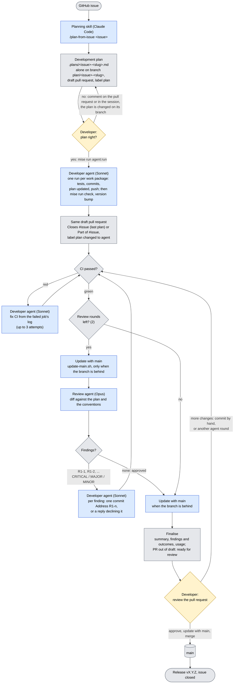

# Agentic development

Agents take a GitHub issue to a reviewed pull request with a green CI. A developer decides at two
points only: approving the plan and merging the pull request (#65). The agents follow the
documented architecture and conventions; the plan they work from is a file in the repository that
the developer reviewed, so their work can be checked against it.

## The flow



Yellow: the developer's two decisions. Blue: Claude Code (the planning skill in an interactive
session; the agents headless, with the developer's login). Grey: GitHub, CI and the scripts in
[`scripts/agent/`](../scripts/agent) that drive the loop and keep its state on the pull request.

| # | Step | Who | Output |
|---|---|---|---|
| 1 | Plan: read the issue and the documents of every part it touches; one plan per reviewable pull request | Claude Code skill `plan-from-issue` | `.plans/<issue>-<slug>.md` |
| 2 | One branch per plan, holding only that plan file, and a **draft** pull request for it | `scripts/agent/plan-branch.sh` (the skill runs it) | `plan/<issue>-<slug>` pushed, draft PR labelled `plan`, linked on the issue |
| 3 | Plan review: comment on the pull request (inline on the plan's lines, or a comment) or in the session; the session reads both (`plan-comments.sh`), changes the plan on its branch and answers each comment; or approve it | Developer, the skill | Plan commits, replies |
| 4 | Start the agents (the approval) | Developer: `mise run agent:run plan/<issue>-<slug>` | — |
| 5 | Implement one work package per agent run, with tests, and push after each; `mise run check`, version bump; the plan's pull request becomes the implementation's (label `plan` → `agent`); fix a red CI | Developer agent: `implement.sh`, `fix-ci.sh` | Draft PR labelled `agent`, **CI passed** green |
| 6 | When the branch is behind `main`, update it first (merge `main` in); then review against the plan and the conventions: one inline comment per finding, with priority and possible solutions | `update-main.sh` (run by `next.sh`); review agent: `review.sh` | Merge commit, PR review + summary comment |
| 7 | One commit per finding (`Address R1-3: …`), or a reply declining it; reply on each thread; push | Developer agent: `fix.sh` | Commits, thread replies |
| 8 | Second review → fix round (6–7 again) | Agents | — |
| 9 | Update with `main` when behind, then finalise: what the plan asked for, what was done, findings fixed / declined / open, usage; the PR leaves draft (ready for review), `agent` label removed | `update-main.sh` (run by `next.sh`), `finalise.sh` | PR ready for review |
| 10 | Review, merge (the branch is usually up to date with `main` already, see 6 and 9); the release follows | Developer | Change on `main`, released |

Agents never merge and never push to `main`: the scripts push only to the plan branch, the agents
cannot run `git push` or `gh`, and `main`'s ruleset requires a code owner's approval and
**CI passed** for every merge anyway.

## Decision

- **Everything runs on the developer's machine, with Claude Code.** Planning, implementation,
  review and fixes all run in Claude Code with the developer's own Claude Code login: the same
  skills, `CLAUDE.md`, subagents and hooks for every step, no API key or other model endpoint to
  manage, and no secrets in GitHub. The agents run headless (`claude -p`); the scripts remove any
  `ANTHROPIC_API_KEY`, `ANTHROPIC_AUTH_TOKEN` or `ANTHROPIC_BASE_URL` from their environment, so the
  login is what they use — unless the DeepSeek endpoint is configured (`scripts/claude-deepseek.sh`),
  in which case the agents use it (both on `deepseek-v4-pro`) and never the login. GitHub is reached
  through the developer's `gh` login and Git credentials, so the developer's pushes start CI as
  usual.
- **Scripts, one per step.** [`scripts/agent/`](../scripts/agent) holds one script per step and
  `run.sh`, which runs them all; mise tasks start them. Each step can also be run, and debugged, on
  its own.
- **The loop follows CI.** After every push the loop waits for **CI passed** on the new head, so a
  review always sees a green head, and a red CI goes to the developer agent first.
- **The pull request is the state.** Every step leaves one comment with a hidden marker
  (`<!-- agent-step step=review round=1 tokens=… -->`). `next.sh` reads the next step from these
  markers and CI's result; nothing else is stored, so an interrupted run continues where it was.
  Comments by other accounts are ignored. The pull request's stage is its label: `plan` (a draft
  under plan review, opened with the plan branch), then `agent` (the implementation and the review
  → fix loop). `next.sh` on a pull request in the plan stage only says it waits for the plan's
  approval. During the implementation, the plan branch is the state (next bullets).
- **Progress is in the plan.** Every work package has a `- **Status**:` line in the plan: `open`,
  `done` (every step ticked, `- [x]`) or `not done: <reason>`. The developer agent sets it and ticks
  the steps in the plan file, in the same commit as the code, and the script reads it back
  (`scripts/agent/plan.py`) to know which package is next and whether one is finished. Every commit of a
  package ends with the trailer `Work-package: WP2`, so `git log --grep '^Work-package: WP2$'` lists
  its commits. The plan does not hold a commit SHA: a commit cannot name its own.
- **One agent run per work package.** `implement.sh` runs the developer agent once per package, in
  the order of the `Depends on` lines, each in a fresh session, and pushes the branch after each
  one. The context of a run stays small, the work survives the machine, and an interrupted
  implementation starts again at the package it was on: the packages the plan on the branch marks
  `done` or `not done` are skipped. A run stops at `AGENT_WP_MAX_TURNS` turns, so one session never
  grows past a few hundred thousand tokens; a fresh agent then continues from the package's commits,
  the uncommitted work and the plan (up to `AGENT_WP_MAX_CONTINUATIONS` times), and the retries of an
  unfinished package or a failed final check start fresh too, instead of resuming the large
  session. The developer agent commits each finished step as soon as its tests pass, so a cut loses
  little. `plan-branch.sh` warns about a package that names more than `AGENT_MAX_WP_FILES` files.
- **Update with `main` is a step script with a fresh agent.** `update-main.sh` merges `main` into
  the branch outside the `develop-issue` session's context and is recorded like every other step.
  A conflict that is only the version lines is resolved by a script
  (`scripts/agent/merge_versions.py`, no agent); any other conflict by a headless agent in a fresh
  context, which commits the resolution but never pushes. `next.sh` runs it before each review
  round and before finalising when the branch is behind (at most once per round), and an approval
  survives an update that only brought in `main`.
- **The state directory is inside `.git`.** Everything a run leaves behind goes to
  `.git/agent/<issue>-<slug>/` of the plan branch: `run.log` (the scripts' and agents' progress
  lines, with the milestone lines `agent: >> …` next to the tool lines), `progress.tsv` (the steps,
  milestones and agent usage behind the [progress comment on the issue](#progress-on-the-issue)),
  every prompt, agent result (`*.json`) and stream (`*.jsonl`), `current` (the package the
  implementation is on) and `run.pid` (the lock). Inside `.git` it is never committed, survives
  `git clean`, and is shared by the worktrees of the repository. A later run, even of another
  script, finds it. It is not deleted by the scripts; delete it after the merge.
- **The plan file is merged with the code.** It stays in `.plans/` as the record of why the change
  looks the way it does.
- **Sonnet develops, Opus reviews.** The developer agent does most of the work (implementing,
  running the checks, fixing), where Sonnet is fast and good enough; the review is a single,
  judgement-heavy pass per round, where the stronger model finds more. Both are settings.
- **A fixed number of rounds**: two review → fix rounds, then the pull request goes to the
  developer, even when `MINOR` findings remain.

## Review findings

Each finding is one inline comment on the line concerned, or on the file when the line is not part
of the diff (a finding outside the diff goes into the review's body):

- an ID, `R<round>-<n>`, that the fix commit (`Address R1-3: <summary>`) and its reply refer to;
- a priority: `CRITICAL` (a bug, data loss, a security problem, a missing plan item: must be fixed),
  `MAJOR` (an edge case, a broken convention, a missing test: should be fixed), `MINOR` (optional);
- the problem, and one or more possible solutions;
- the other places with the same problem ("Same finding also at"), instead of a comment each.

The review checks the diff against the plan (missing items, out-of-plan changes), correctness,
the conventions of the parts it touches, tests and docs. The summary comment counts the findings
per priority and says whether another round is needed.

**A round with no findings approves the reviewed commit**: the review says "✅ Approved by the review
agent" with the commit, and the loop goes straight to finalising: no empty fix round, and no second
review of the same commit. The approval is a review comment, not a GitHub approval: the agents work
as the pull request's author, and GitHub does not let an author approve their own pull request. The
code owner's approval is still what the merge needs. The final comment says whether the review agent
approved the latest commit.

The developer agent handles one finding per run, most severe first. A fix becomes one commit
through the pre-commit hook; a finding it disagrees with gets a reply with the reason instead of a
change. A thread a developer resolves before the fix round is skipped.

## From issue to `main`: a walkthrough

What a developer does, from an issue to its change released on `main`. The agents do everything
between "start the agents" and "review the pull request".

### 0. Once per machine

```sh
mise run setup      # ta-runner, the frontend's packages and the Git hooks the agents commit through
claude              # then /login: the agents use this Claude Code login
gh auth login       # the scripts push, comment and open pull requests as you
```

### 1. The issue

The agents work from the plan, and the plan from the issue, so the issue needs a clear goal, steps
and "done when" (the shape of the existing issues). A vague issue gives a vague plan: sharpen the
issue first, it is cheaper than reviewing a wrong plan.

### 2. Plan it

In Claude Code, in this repository:

```text
/plan-from-issue 32
```

The skill ([`.claude/skills/plan-from-issue/SKILL.md`](../.claude/skills/plan-from-issue/SKILL.md))
always plans on Opus, whatever model the session uses and however it is started (typed, or invoked
by `develop-issue`): the session hands the work to an Opus subagent. It
reads the issue, the issues it links to and the documents of every part it touches, and writes
`.plans/<issue>-<slug>.md` from [`plan-template.md`](../.claude/skills/plan-from-issue/plan-template.md),
or several plans when the issue does not fit one pull request. Discuss it with Claude in the same
session; when it is ready for review, the skill pushes one branch per plan
(`mise run agent:plan-branch .plans/<issue>-<slug>.md`), opens a draft pull request labelled `plan`
for it and links that on the issue. The local plan file is removed once its branch is pushed, so
the working tree is clean for step 4.

The scripts read the plan's work packages, so their format is fixed: a `### WP<id>: <name>` heading,
a `- **Status**: open` line (the agent sets `done` or `not done: <reason>` and ticks the steps), a
`- **Depends on**:` line with package IDs (`none`, `WP1, WP2`, a range `WP2–WP4`), optionally followed by a
reason in parentheses, and `- [ ]` steps. A plan without `Status` lines counts every package as
`open`; a plan without work packages is one package.

### 3. Review the plan

This is the first of the two decisions that are yours. Read the plan on the draft pull request
(its only change is the plan file) and check:

- the goal matches the issue, and "Out of scope" leaves out what it should;
- each part names the right conventions, and the design puts the code where they say;
- every work package has its tests, and the tests prove the issue's "done when"; every `Status` is
  `open` and the `Depends on` lines are right (they decide the order the agent works in, and each
  package is pushed on its own, so it should leave the repository green); no package names more
  than `AGENT_MAX_WP_FILES` files (8, tests included; `plan-branch.sh` prints a warning for one
  that does, and the planning session shows it);
- the version bump (`minor`, `major` for a breaking change);
- "Docs to update" covers the text of the feature's topic file in `docs/` and every screenshot: a
  new page gets one, a page whose look changes gets it retaken. "Later" is not an option: the
  review agent checks the docs and screenshots, and a missing one is a `MAJOR` finding;
- the open questions: answer them in the plan.

Say what to change where you prefer: inline on the plan's lines or as a comment on the pull request,
or to Claude in the session. The session reads the pull request's comments that have no answer yet
(`mise run agent:plan-comments <pr | branch>`; the session's replies carry a hidden `plan-reply`
marker), changes the plan on its branch (commit `Plan: …`, push) and answers every comment with
`plan-comments.sh --reply <comment id> <file>` or `--comment <pr> <file> <id>...` (the IDs of the comments or reviews it answers), saying what changed or why
not. It never resolves a thread: you do. You can also edit, commit and push the plan yourself.
Approving the plan in the session records it on the pull request: `plan-comments.sh --approve <pr |
branch>` posts a comment with a hidden `plan-approved sha=<sha>` marker for the branch's pushed head
(it refuses unless the local branch is that head, so the sha is the one the session showed), and `plan-comments.sh --approved <pr | branch>` prints the
sha and exits 0 when the newest such comment of the agent's login names the current head, 1 when
there is none or a later plan commit made it stale. Go on
until you would accept a pull request that does exactly that. The agents follow the plan literally,
and the review agent checks the code against it. A plan-only pull request needs no version bump
(CI's *Version* job passes).

### 4. Start the agents

Approve the plan in the session, or:

```sh
mise run agent:run plan/32-compare-runs
```

From a clean working tree (the scripts switch to the plan branch). It runs steps 5–9 of the flow:
the developer agent (Sonnet) implements the plan one work package at a time, each with its tests,
commits and update of the plan, and the script pushes the branch after every package (that starts
CI, which cancels the run of the previous push). Then the script checks the whole, the last package
bumps the version, and it takes over the plan's draft pull request: new title and body
(`Closes #<issue>`, or `Part of #<issue>` while other plans of the issue are not merged yet), label
`plan` changed to `agent` (a branch without a plan pull request gets a new draft one); after **CI passed**, the
review agent (Opus) reviews it, the developer agent fixes the findings, CI runs again, and once
more; then the pull request gets a final comment and is marked ready for review. It waits for CI
after every push, so it takes a while: leave the terminal open. Follow it on the pull request,
where every step leaves a comment, or in the terminal: while an agent runs, each of its steps (tool
call, message, to-do) is printed as one line with the time since it started, and after two quiet
minutes (a long build) a "still working" line. The same lines go to
`.git/agent/<issue>-<slug>/run.log` (appended, one header line per start), next to every agent's
result and full stream (`wp-WP2.json`, `wp-WP2.jsonl`, `review-1.json`, …); the paths are printed
as the first lines of every step.

Between the tool lines, one **milestone line** per event starts with `agent: >> `: a work package
started or done, tests, `mise run check` and its result, a commit, a push, the draft pull request,
CI waiting, passed or failed (with the failed jobs), a review round and its findings, a fix round and
each finding's outcome, finalise, and a stop with its reason. `grep '^agent: >> ' run.log` lists
them. `mise run agent:status plan/32-compare-runs` (or a pull request number) shows where a run is:
the active process, the pull request and its stage (plan review, agent loop, ready for review),
the work package, the latest milestones and the end of `run.log`.
`scripts/agent/status.sh --follow <branch | pr>` prints only the milestones written from now on.
A second run on the same branch is refused while one is active (the lock,
`run.pid` in the same directory).

##### Progress while it runs

The milestones reach the developer without a model turn:

- **The `agent-progress` mod** ([`.claude/mods/agent-progress`](../.claude/mods/agent-progress)) shows
  the latest run of the repository in a Claude Code session: a status line (issue, step, work
  package, minutes in the step, tokens), a toast for each milestone (`WP2 (2 of 4): done`, `CI
  passed`, `review R1: 3 findings (0 CRITICAL, 2 MAJOR, 1 MINOR)`, `failed: …`) and, with
  `/agent-progress`, a pane with the latest milestones. It reads `progress.tsv` and `run.pid` in
  `.git/agent/` every few seconds, so it works for a run started by `/develop-issue`,
  `mise run agent:run` or `detach.sh`, from any worktree. `mise.toml` sets
  `CLAUDE_CODE_PLUGIN_DIRS` to it, so **start `claude` from a shell where mise is active**
  (`mise activate` in your shell, or `mise exec -- claude`); a `claude` started without mise shows
  no progress (the run itself is unaffected). Without mise, use
  `claude --plugin-dir .claude/mods/agent-progress`.
  Turn it off by leaving it out.
- **A push to the phone** through [ntfy](https://ntfy.sh): `export AGENT_NTFY_TOPIC=<a topic nobody
  guesses>` (`AGENT_NTFY_SERVER` for a server of your own). This sends the milestone lines, which
  name the issue and the pull request, to an external service: it is off unless the topic is set.

##### Progress on the issue

The issue gets one **progress comment** per plan branch, posted by the first step and edited in
place as the run goes on, so it says at any time, and after the run, what was done, when and at
what cost. It is meant for looking into a run afterwards: which steps completed the issue, which
ran long, where it was blocked or slow, what ran more than once, and the total time and tokens.
It holds no tool calls and no file-level detail, only:

- **status**: running (the step and work package), ready for review, stopped, failed or
  interrupted; the pull request, the start, the last update, the elapsed time, the agents' runs and
  time, the tokens and the cost at API prices;
- **steps**: every step (plan, implement with each work package and the final checks, each CI wait,
  CI fix, review round, fix round, finalise, update with `main`) with its start, end, duration,
  tokens, cost and result (its last milestone, or why it failed);
- **iterations**: per kind of step, the runs (out of `AGENT_MAX_ROUNDS` and `AGENT_MAX_CI_FIXES`),
  the time, the tokens and the outcomes (work packages done / not done, CI passed / failed, the
  findings per review round);
- **worth a look**: the slowest steps, the time spent waiting for CI, steps that ran more than once,
  the agents' retries, failed or interrupted steps, and the CI fixes and updates with `main` the
  run needed;
- a **Usage** table with a row for every step that used the model: the model(s) that ran it, input,
  cached input and output tokens, the cost at API prices, and the Claude 5-hour and weekly limit
  before the step, after it and the difference (`12% → 15% (+3)`). The plan, the update with `main`
  and the **orchestration** (the session's own usage outside those two, from the start of `run.sh`
  to the ready-for-review notification) have rows of their own. The **Total** row covers
  everything the issue consumed, with the limit consumption from the first *before* to the last
  *after*; it says `at least` when a row has partial or unknown usage. A value that cannot be read
  is `n/a` and never fails a step. The finalise comment on the pull request holds the same table
  for the steps the scripts ran; it cannot hold the rows recorded after it;
- a collapsed **timeline** of the milestones with their times.

Where the usage numbers come from:

- **Agent runs** (implement, fix-ci, review, fix): the `rate_limit_event` lines of the run's own
  stream (`<step>.jsonl`) carry the 5-hour and weekly utilization, and its `init` event the model.
  *Before* is the first event of the run, *after* the last one, so the run's first model turn is
  not in the difference. A step of several runs takes *before* from the first and *after* from the
  last. A run without such events (an API key, the DeepSeek endpoint, an older Claude Code) shows
  `n/a` for the limits.
- **Plan, update with `main`, orchestration**: they run in the developer's own session, which has
  no stream. Tokens, model and cost come from the session's transcript
  (`~/.claude/projects/…/<session id>.jsonl`), the assistant messages inside the step's window; the
  cost is computed from a price table in `scripts/agent/agent_json.py` (a model that is not in it
  has no cost, `n/a`). The limits come from a **limit probe**: `progress.sh` makes one headless
  call to Haiku (a one-word prompt, no tools) at the start and the end of the window (`begin` makes the first; the plan, recorded after its
  approval with `begin --at <epoch> --limits "<line>"`, gets it from `progress.sh probe` without a branch, which the skill runs when the window starts, before the branch exists; the
  orchestration gets it from `progress.sh probe <plan branch> orchestration`, which the skill runs right before it starts `run.sh`)
  and reads its `rate_limit_event`. The probe costs a few tokens, counted in no row. A transcript that cannot be
  found or a failed probe gives `n/a`.
- **The limits are shared** with everything else the developer runs with the same account at the
  same time, so a difference is an approximation, not what the step alone consumed. The comment
  says so under the table.

Each step script records its own steps in `progress.tsv` ([`lib.sh`](../scripts/agent/lib.sh),
`step_begin`) and updates the comment in the background at every milestone, and once more when it
ends. A failing or interrupted script still records its end. The steps a Claude Code session runs
on its own (the plan and its approval, the update with `main`) are recorded with
`progress.sh begin|end`, and the orchestration with `progress.sh orchestration <pr>`;
`progress.sh usage <branch | pr>` prints the Usage section alone. `mise run agent:progress <branch | pr>` prints the comment without posting
it, `scripts/agent/progress.sh post <branch | pr>` posts it again. With `AGENT_ISSUE_PROGRESS=0` the
progress stays in `progress.tsv` and nothing is posted.

The scripts run from a copy of `scripts/agent/` taken at start, so switching branches does not
change the running scripts or prompts. Each step can also be run on its own:

```sh
mise run agent:implement plan/32-compare-runs        # implement, push, draft pull request
scripts/agent/implement.sh --dry-run plan/32-compare-runs # work packages and their status, what a run would do
scripts/agent/next.sh --dry-run plan/32-compare-runs # which step is next
mise run agent:next plan/32-compare-runs             # continue the loop to its end
scripts/agent/review.sh <pr>                         # one step: review, fix, fix-ci, finalise
```

`AGENT_BASE_BRANCH=<branch>` starts the plan branch from, and opens the pull request into, another
branch than `main` (a stacked change, or trying out a change to the agents themselves); later steps
use the pull request's base.

To keep a run going when the terminal (or the Claude Code session) closes, start it detached:

```sh
mise run agent:detach run.sh plan/32-compare-runs    # or implement.sh, next.sh <pr>, …
tail -f .git/agent/32-compare-runs/run.log           # follow it
kill -- -<pid>                                       # stop it (the pid printed at the start)
```

`detach.sh` starts the script in a new session with its output in `run.log`, and prints the process
ID and the log. Stopping it releases the lock; started again, the run resumes (see below).

#### From Claude Code, with one approval: the plan

The `develop-issue` skill
([`.claude/skills/develop-issue/SKILL.md`](../.claude/skills/develop-issue/SKILL.md)) goes through
steps 2 to 8 of this walkthrough in one Claude Code session. It works in a folder of its own: a
Git worktree `../<checkout>-<issue>` checked out from `origin/main` (reused when it exists), so it
never switches branches or writes in the checkout the session started in, and several issues can
run side by side. It asks the developer only to approve the plan; when the issue has a plan branch
already, it first asks whether to use that plan, skipping the writing, or to write it again. Every later step runs without asking: pushing the plan branch, the implementation, each CI
fix, review, fix round and the finalising, and the update with `main` (run by `update-main.sh`, not in
the session's own context; the session runs on Sonnet, its turns are routine). When the pull request is
ready for review (up to date with `main`, **CI passed** green), it first posts a run summary on
the pull request ("Run summary (develop-issue session)": the review outcome, what is worth checking,
the checks it ran itself, the steps and the usage), then sends a notification; when the run stops
early, it only notifies. It never merges: merging stays the developer's decision, and the skill merges
only when asked to in the session.

```text
/develop-issue 32
/develop-issue https://github.com/<owner>/<repo>/issues/32
```

It records its own steps (the plan with the time the approval took, the update with `main`, and
one summed **orchestration** step for the rest of the session) in the
[progress comment on the issue](#progress-on-the-issue) next to the scripts' steps, each with its
tokens, cost, model and limit usage (from the session transcript and a limit probe, see there). At
the end the run summary on the pull request carries the Usage section (`progress.sh usage <pr>`).
It plans with the `plan-from-issue` skill, run in a subagent that returns only each plan's path, branch, pull
request link and a short summary, and each round of review comments is handed to a subagent in the
same way, so the session does not carry what the plan was written from. On the approval it records
the plan step, pushes the plan branch, posts the `plan-approved` comment on the plan's pull request
(`plan-comments.sh --approve`) and ends with "approved; run `/clear`, then `/develop-issue <n>`".
The approval is tied to the plan's head commit and lives on the pull request, so it survives `/clear`
and a new session: the next `/develop-issue <n>` finds it with `plan-comments.sh --approved` and
goes straight to the implementation without asking again, while a plan changed after the approval
is asked about again. The implementation therefore starts from a context of the skill, the plan
and the approval, well under 100k tokens, and every model turn that follows re-reads far less.
It then starts `run.sh` once, detached
(`detach.sh run.sh plan/<issue>-<slug>`), exactly what `mise run agent:run` runs, so the pull request
and its state comments are the same and `mise run agent:next` can take over at any point. Every
model turn of the session re-reads its whole context, so the session is not woken for each
milestone or CI wait: one Monitor on `status.sh --follow`, filtered to the end of the run
(`failed:`, `stopping:`, ready for review), wakes it. The developer sees the milestones as they
happen in [the `agent-progress` mod and the ntfy push](#progress-while-it-runs), and can follow
`tail -f .git/agent/<issue>-<slug>/run.log` in a terminal; ask the session for the status at any time
(`status.sh`). The loop already updates the pull request with `main` before each review round and
before finalising (step 8), so when the run ends ready for review the branch is usually up to date;
when `main` moved since, the session starts `detach.sh update-main.sh <pr>` and waits for it, so the
run stops there only on a conflict that cannot be resolved with confidence. It then posts the run
summary and sends the notification. The agents may not edit the skills
under `.claude/`, so a plan item there comes back "not done" and is done by hand. Started again, it
reads where the issue stands from its plan branches and pull requests and continues there.

### 5. When a run stops early

- **Ctrl+C**, a closed laptop, a crash, a usage limit: start `mise run agent:run` again; it
  continues where it was. During the implementation the state is the plan on the branch: the
  packages it marks `done` or `not done` are skipped, and the uncommitted work of the package that
  was interrupted stays in the working tree, where the agent is told to read it, keep what is right
  and finish it. Nothing is discarded. (`implement.sh --dry-run <branch>` shows which package that
  is.) The pull request is opened as in an uninterrupted run. Later, the state is the pull request.
  The tokens of the interrupted run are counted from its stream in the step's usage, marked
  partial: the cost shows as "at least", because an interrupted run's cost is unknown.
- **A run is already active** (`a run is already active: pid …`): the lock of the branch is held by a
  live process. Follow it in its `run.log`, or stop it (`kill -- -<pid>` for a detached one). A lock
  of a process that is gone is replaced.
- **The loop gave up** (a comment "Agent loop stopped", the `agent` label removed, the pull request
  still a draft): CI stayed red after `AGENT_MAX_CI_FIXES` attempts, the developer agent found no
  fix, CI took longer than `AGENT_CI_TIMEOUT`, or the run went over `AGENT_MAX_TOKENS`. Fix the
  cause by hand on the plan branch (or not at all), then either continue by hand, or add the
  `agent` label again and run `mise run agent:next plan/<issue>-<slug>`.
- **To stop it yourself**: Ctrl+C, or remove the `agent` label (the loop does nothing on the pull
  request any more).

### 6. Review the pull request

The second decision that is yours. Start with the final comment ("Done: ready for review"): whether
the review agent approved the latest commit, the plan's work packages, the commits, every review
finding with its outcome, and the usage. A run from Claude Code (`/develop-issue`) adds a "Run
summary" comment after it: what the session checked itself and what is worth checking. Then:

- **Open and declined findings** first: an open one was not addressed (a fix that failed the
  pre-commit hook, or a round that did not run); a declined one has the developer agent's reason in
  its thread. Decide each.
- Read the diff as you would any pull request: against the plan, with the conventions in mind. The
  agents' review covered it twice, but it is not a substitute for yours.
- The docs: the topic file of `docs/` describes the feature, and the screenshots in
  `docs/screenshots/` show it (the pull request's *Files changed* shows the PNGs side by side with
  the old ones).
- Try it: `git switch plan/<issue>-<slug>` and `mise run dev` (or `mise run run`).

### 7. More changes

- **Small ones**: commit them yourself on the plan branch and push. CI runs as for any pull request.
- **Another agent round**: turn the pull request back into a draft, add the `agent` label and raise
  the round limit:

  ```sh
  gh pr ready <pr> --undo && gh pr edit <pr> --add-label agent
  AGENT_MAX_ROUNDS=3 mise run agent:next plan/<issue>-<slug>
  ```

  The review agent runs a third round and the developer agent fixes its findings. The agents do not
  read your own review comments; to steer them, change the plan on the branch first (the review
  agent reads it every round).
- **Wrong direction**: close the pull request, fix the plan (or the issue), and start again from
  step 2 with a new plan branch.

### 8. Bring it up to date with `main`

The `main` ruleset merges only a pull request whose branch is up to date with `main`, whose
**CI passed** is green, and that a code owner approved (see
[CI and releases](ci-and-releases.md#continuous-integration)). If `main` moved while the agents
worked, merge `main` into the branch. Unattended, `mise run agent:update-main <pr | plan
branch>` (or `scripts/agent/detach.sh update-main.sh <pr>`) does it as a recorded step: up to date →
nothing happens; a merge without conflicts is committed and checked (`mise run check`, an agent
adapts the code when it fails); conflicts that are only the version lines are taken from `main` by
a script; any other conflict is committed as it is (markers included, `--no-verify`) and resolved
in a commit of its own by a headless agent. The version is bumped again when `main` caught up, and
the merge, the resolution and the bump are pushed together; `--bump major|minor|patch` overrides
the plan's "Version bump". The review → fix loop (`next.sh`) runs it itself before each review
round and before finalising when the branch is behind, so this step is usually already done. An
unresolved conflict stops the run with the merge left local; finish it by hand or drop it with
`git reset --keep @{u}`.

By hand, with the Claude Code skill
[`merge-main-into-branch`](../.claude/skills/merge-main-into-branch/SKILL.md), in a checkout of the
branch:

```text
/merge-main-into-branch
```

It merges `origin/main` in, commits the merge as it is (conflict markers included, the only commit
that skips the pre-commit hook), and resolves the conflicts in a second commit of its own from the
branch's commits, `main`'s commits on the same lines and the plan; its body says how each file was
resolved and why, and `git show <commit>` shows the resolution alone. It bumps the version again
when `main`'s caught up (`Bump version to X.Y.Z`), runs `mise run check` and pushes all of it at
once, without force, so CI runs on the resolved head only. A conflict it cannot resolve with
confidence (the two sides change the same behaviour and the plan does not decide it) makes it stop
and ask, with nothing pushed. A rebase still works for a branch without conflicts:

```sh
git fetch origin && git switch plan/<issue>-<slug> && git pull
git rebase origin/main
mise run version:bump minor       # only if main's version caught up with this branch's
git push --force-with-lease
```

The **Version** job fails when another pull request merged the same version first
([versioning and releases](coding-convention/repository-versioning-and-releases.md)): bump again. Wait for
**CI passed** on the new head.

### 9. Merge

Approve and merge it yourself; nothing merges on its own (auto-merge is off) and the agents never
merge:

```sh
gh pr merge <pr> --rebase --delete-branch
```

A branch that `main` was merged into (step 8) is merged with `--merge` instead: GitHub cannot
rebase-merge it, since the branch's own commits would run into the conflicts again.

A pull request into another branch than `main` (`AGENT_BASE_BRANCH`) is retargeted to `main` once
the branch it stacks on has merged: `gh pr edit <pr> --base main`, then step 8.

### 10. After the merge

- CI runs on `main`; after **CI passed**, [`release.yml`](../.github/workflows/release.yml) tags
  the commit `vX.Y.Z` and publishes the GitHub Release with the jar.
- `Closes #<issue>` in the pull request closes the issue. A split issue stays open until the
  pull request of its last plan has merged: the scripts write `Closes #<issue>` only when every
  other `plan/<issue>-*` branch has a merged pull request, and `Part of #<issue>` otherwise. They
  decide when the pull request is opened and again when it is marked ready for review. When two
  plans of an issue are ready at the same time, neither closes it: close the issue by hand after
  the second one merges, or change its `Part of` to `Closes` before merging it.
- The plan stays in `.plans/` on `main`, next to the code it explains.
- Locally: `git switch main && git pull`, and delete the local plan branch
  (`git branch -D plan/<issue>-<slug>`) and its state directory
  (`rm -rf .git/agent/<issue>-<slug>`).

## Documentation and screenshots

A change is documented in its own pull request: the plan lists the documents and screenshots it
affects ("Docs to update"), the developer agent updates them, and the review agent checks them
against the plan and on its own (a user-visible change without its description or screenshot is a
`MAJOR` finding).

The docs' screenshots (`docs/screenshots/*.png`, shown in the topic files of `docs/` and the
README) are taken by Playwright, the way the end-to-end tests run: the built jar with a throwaway
home and ta-runner replaying a recording, in Google Chrome, at 1440×900 in the dark theme. One
`e2e/screenshots/<name>.shot.ts` per screenshot sets up the data it needs over the API, opens
the page and saves it with `shot(page, '<name>')`:

```sh
mise run screenshots             # every screenshot
mise run screenshots compare     # those whose file or title matches "compare"
```

`SCREENSHOT_DIR=<dir>` writes them elsewhere (a relative path counts from the repository root), to
try one out. The agents never open a PNG
(`Read(**/*.png)` is denied): `mise run screenshots` ends with a report, one line per written image
(dimensions, size, new, changed or unchanged), and fails on a likely blank or tiny image (under 100
pixels, or nearly uniform). Whether a screenshot looks right is checked by the developer in the pull
request. Screenshots taken by hand from real runs stay until a change retakes them.

## Measuring the usage

`mise run agent:stats <issue>` summarises the agent transcripts of an issue, as Markdown ready to
paste into an issue comment: a table per step (implement, review, fix, CI fix, update with main,
session) and per transcript with turns, maximum context, cached, uncached and output tokens and
cost; the tools table (calls, output characters, share, images); and the files read more than twice.

- It reads Claude Code's transcripts in `~/.claude/projects/<folder>/`, by default the folder of
  the issue's worktree (`--folder` for another), and matches each session to a step through the
  results in `.git/agent/<issue>-*/` (`--state` for another directory).
- The orchestration session runs in the main checkout and is shared by every issue: add it with
  `--transcript <file>` and cut it to the issue's run with `--since` / `--until` (epochs, from the
  progress comment's start and end).
- `--json` prints the same numbers as JSON.

Issue #244 holds the baseline to compare a run with.

## Settings

Environment variables of the scripts ([`lib.sh`](../scripts/agent/lib.sh)):

| Variable | Default | What |
|---|---|---|
| `AGENT_MODEL` | `claude-sonnet-5-5` (`deepseek-v4-pro` on the DeepSeek endpoint) | The developer agent's model (implement, fix-ci, fix) |
| `AGENT_REVIEW_MODEL` | `claude-opus-5-5` (`deepseek-v4-pro` on the DeepSeek endpoint) | The review agent's model |
| `AGENT_MAX_ROUNDS` | 2 | Review → fix rounds |
| `AGENT_MAX_CI_FIXES` | 3 | Attempts at a red CI, per pull request |
| `AGENT_WP_MAX_TURNS` | 40 | Turns of one work package agent run; at the limit a fresh agent continues |
| `AGENT_WP_MAX_CONTINUATIONS` | 3 | Fresh continuations of a work package after a turn limit, before it counts as unfinished |
| `AGENT_MAX_WP_FILES` | 8 | Files a work package may name (tests included); `plan-branch.sh` warns about more |
| `AGENT_MAX_TOKENS` | 50 000 000 | Tokens per pull request, cached input included |
| `AGENT_MAX_BUDGET_USD` | none | Per agent call (`claude --max-budget-usd`) |
| `AGENT_CI_TIMEOUT` | 60 | Minutes to wait for CI after a push |
| `AGENT_BASE_BRANCH` | `main` | Where plan branches start and pull requests go |
| `AGENT_ISSUE_PROGRESS` | 1 | 1: keep the [progress comment](#progress-on-the-issue) on the issue up to date; 0: `progress.tsv` only |
| `AGENT_NTFY_TOPIC` | none | An ntfy topic that also receives each milestone; sends progress lines to an external service (`AGENT_NTFY_SERVER`, default `https://ntfy.sh`) |

`run_agent` also sets `AGENT_QUIET=1` for every agent (a developer may set it too): `mise run check`,
`format`, `format-check`, `runner-test`, `gradle` and the Git hooks then print one `ok:` line on
success, and on a failure an excerpt and the path of the full log in `build/quiet/<name>.log`
([`scripts/quiet.sh`](../scripts/quiet.sh)). Without it they print everything, as before.

Costs in the final comment are Claude Code's own figures at API prices; with a subscription login
they show the usage, not a bill. The usage of runs from before the state directory existed, or of
a state directory that is gone (another machine), is not available; the implement comment says so.

## Safety

- The agents run with an allow-list of tools (`--permission-mode dontAsk`): no `git push`, no
  `gh`, no skipping the Git hooks, no web search; the review agent only reads. The scripts do every
  push and every GitHub call.
- What the agents read is the reviewed plan, the code, CI's logs and their own review comments,
  not comments by other accounts.
- The agents run real commands (Gradle, pnpm, uv) on the developer's machine, like a developer
  would; run them only on plans you reviewed.
- Reading a PNG is denied (`Read(**/*.png)`): screenshots cost many tokens, and the agents check
  the report of `mise run screenshots` instead.

## Not done yet

- **Parallel work packages** each in their own `git worktree` (#70): for now the packages run one
  after the other, one agent run each; the per-package loop (`plan.py next`) is what parallel runs
  will build on.
- **Sub-issues** for the plans of a split issue.
